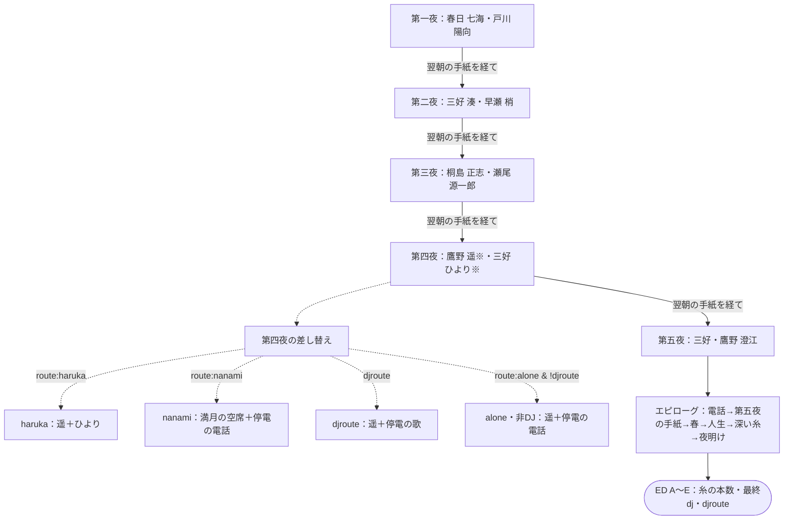

# 深夜の相談室 — 全体マップ

> 自動生成：`node tools/generate-branchmaps.js`。実装の動作を記述。ネタバレを含みます。

最初にこの図で夜の順番を確認し、気になる夜だけリンク先を開いてください。※の相談者は条件により来訪しません。各夜にナツメ・猫の場面、閉店後の独白、追加の短い場面があります。

- [[nights/第一夜|第一夜]]：細い月と、ふたつめの角砂糖
- [[nights/第二夜|第二夜]]：風の夜と、取り違えたマグ
- [[nights/第三夜|第三夜]]：雨の音と、欠けた取っ手
- [[nights/第四夜|第四夜]]：満月と、三本のろうそく
- [[nights/第五夜|第五夜]]：初雪と、一輪の寒椿
- [[10_ルートとED|ルート・人物の糸・ED]]
- [[20_フラグ依存関係|選択が後にどう響くか]]
- [[30_検証と要確認|確定した到達性と再現手順]]
- [[00_全体マップ.canvas|動かせるCanvas]]

## 読み方

進行分岐はシーンやラベルの移動、状態分岐は数値・フラグによる表示や判定の変化、物語上の分岐は人物関係や人生の描写への影響です。進行は夜別図、状態は表と依存図、物語上の意味は根拠を添えた説明に分けています。

実線＝進行、条件ラベル付き実線＝条件つき進行、破線＝状態への依存、ひし形＝選択・判定、太枠＝重要なルート判定、丸い終端＝終了。図中の選択番号は、元の `choice` / `acts` 配列の1始まりです。会話の全文は省き、同じ遷移先をまとめています。

## 到達性の凡例

グレーの破線ノード・矢印＝**到達不能（論証）**。**到達可能（再現確認）**＝初期状態から実エンジンで再生済み。状態リンクから検証資料の該当見出しへ移動できます。判定は記載したソース位置とtrue／false側だけに適用します。通常色の図や「個別判定なし」は到達可能の保証ではありません。通常の破線は状態依存にも使います。
## 実装上の要点

- 人生の `route()` は七海／遥／ひとりの3種。ナツメは `routeKey()` が返す追加の表示キーで、人生はひとりです。EDとは別の軸です。
- 第二夜は湊→ナツメ→梢の順。`djAt2` はナツメの場面終了時に記録されるため、湊終了直後の人生判定は暫定です。
- 第三夜の朝の `kiri_ask → kiri_job` を飛ばさず確認してください。
- 第五夜の朝と手紙はエピローグの冒頭の電話の後です。

進行の根拠：[index.html](../../index.html) L1192 `playNight()`、[index.html](../../index.html) L1226 `morningLetters()`、[index.html](../../index.html) L1306 `playEpilogue()`。設定資料の旧案より実装を優先しています。
