# ルート・人物の糸・エンディング

> 自動生成：`node tools/generate-branchmaps.js`。実装の動作を記述。ネタバレを含みます。

[[00_全体マップ|全体へ]]

## 到達性の凡例

グレーの破線ノード・矢印＝**到達不能（論証）**。**到達可能（再現確認）**＝初期状態から実エンジンで再生済み。状態リンクから検証資料の該当見出しへ移動できます。判定は記載したソース位置とtrue／false側だけに適用します。通常色の図や「個別判定なし」は到達可能の保証ではありません。通常の破線は状態依存にも使います。

## 三好の人生：route()

上から先に成立した条件を採用します。[index.html](../../index.html) L554 `route()`。第二夜の湊終了時は暫定、ナツメ終了後は入口の値が保存されます。関数は都度評価され、ルート文字列そのものを第二夜に保存する実装ではありません。

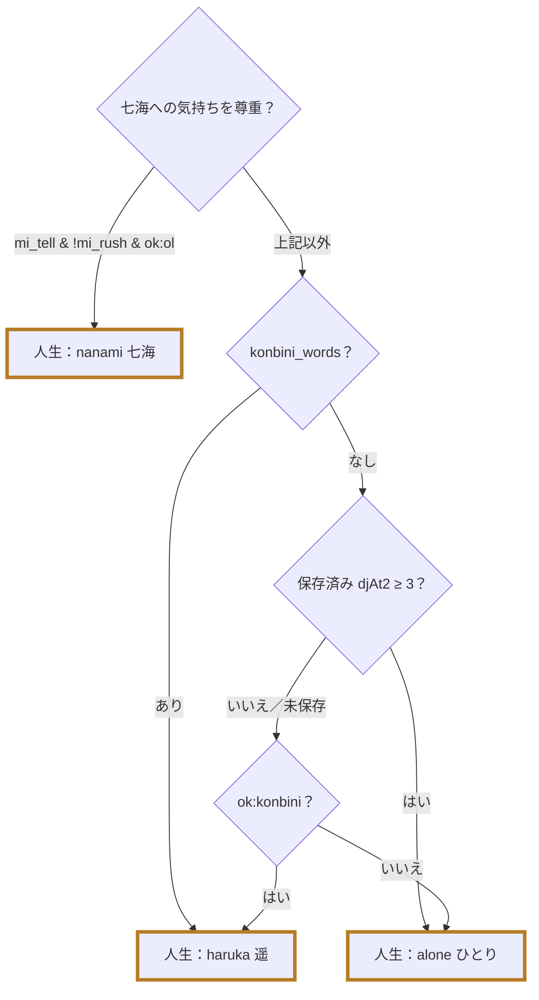

## ナツメ：djRoute() と routeKey()

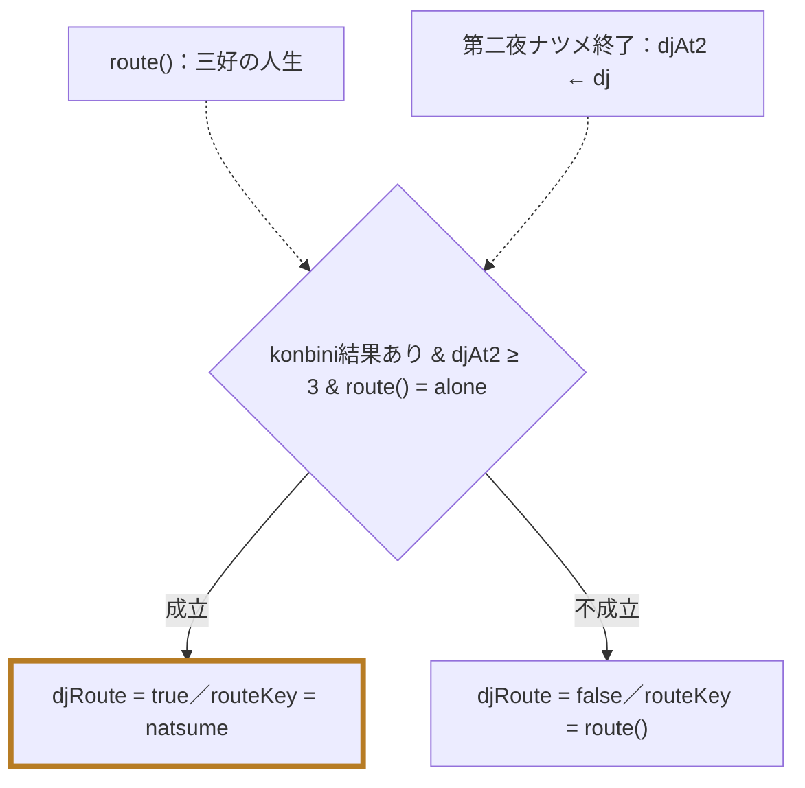

根拠：[index.html](../../index.html) L564 `djAt2High()`、[index.html](../../index.html) L567 `djRoute()`、[index.html](../../index.html) L568 `routeKey()`。`djAt2` は第一夜と第二夜の累積値。現在の dj とは別です。

## 最終ED：人生ルートと独立した判定

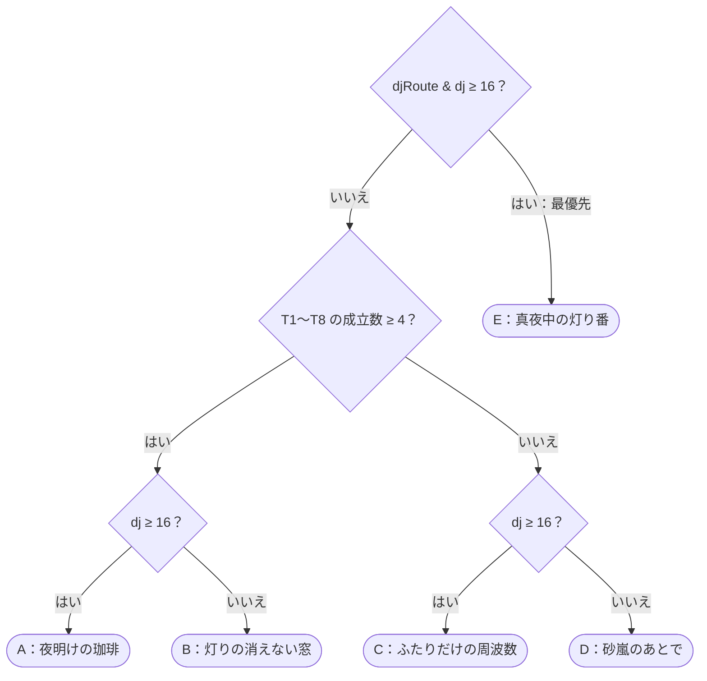

根拠：[index.html](../../index.html) L1305 `decideEnding()`。E が優先され、N1 は conn の本数に入りません。`keep_light` はEの判定条件ではありません。ナツメ入口に入っても、最終djが低い場合はBまたはDです。alone/A・B・Cも到達可能（実エンジンで再生確認済み）。全ルート×EDの確定判定・選択列は [[30_検証と要確認#ルート×ED（全行・確定）|検証結果]] にあります。

| ED | 到達条件 |
| --- | --- |
| E | djRoute & dj ≥ 16 |
| A | !djRoute & conn & dj ≥ 16 |
| B | conn & dj < 16 |
| C | !djRoute & !conn & dj ≥ 16 |
| D | !conn & dj < 16 |

## 人物同士のつながり：T1〜T8・N1

[index.html](../../index.html) L541 `tieOn()`。`ok:ID` はgoodまたはmid。未訪問の人物はokになりません。物語上の名称は [BIBLE §6・§11](../../story/BIBLE.md) と実装の `epilogue.threads / life` に対応します。

| 糸 | 物語上のつながり | 成立条件 |
| --- | --- | --- |
| T1 | 七海と桐島 | `ok:ol & ok:salaryman & うち1人以上good` |
| T2 | 七海と湊 | `ok:ol & ok:konbini & うち1人以上good` |
| T3 | 陽向と梢 | `ok:student & ok:musician & うち1人以上good` |
| T4 | コースターから仕事へ | `kiri_job & ok:salaryman & ok:konbini` |
| T5 | 遥とひより | `ok:mother & ok:child & うち1人以上good` |
| T6 | 遥と澄江の和解 | `wakai` |
| T7 | 源さんと千鶴の電話 | `ok:grandpa & (ok:madam OR cat ≥ 3) & (good:grandpa OR good:madam OR cat ≥ 4)` |
| T8 | 三好の三つの夜 | `ok:student & ok:konbini & ok:freelance & うち1人以上good` |
| N1 | ナツメ・店・番組の灯り | djRoute()（connには含めない） |

### 七海・三好・仕事と歌

関係図の矢印は対応する人物・状態を示します。成立条件は上表を参照してください。

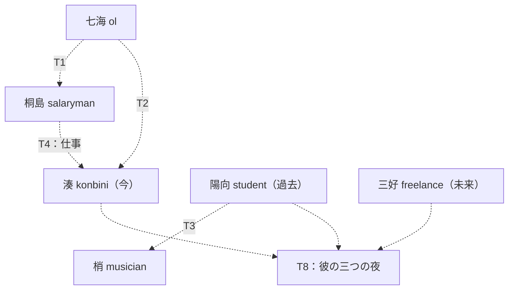

### 家族・源さん・ナツメ

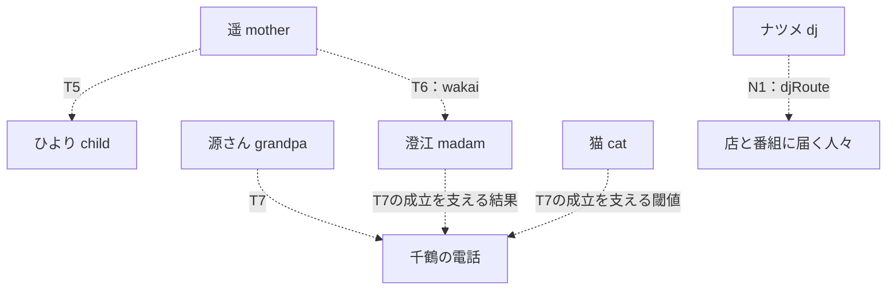

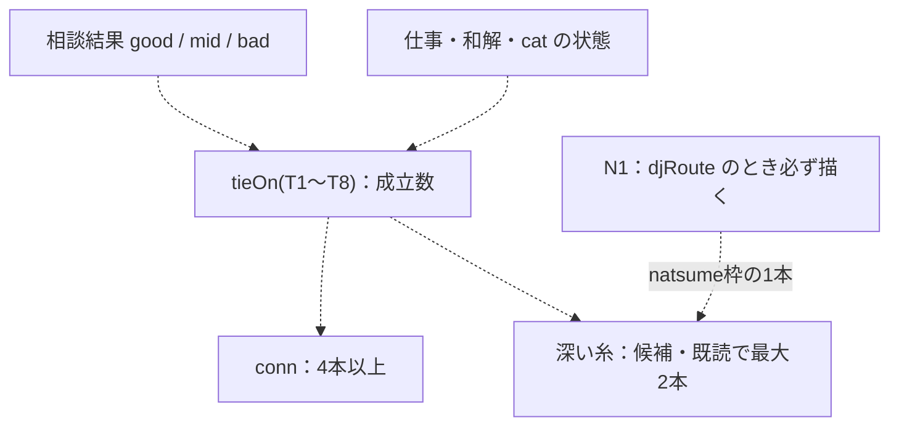

### 和解 wakai

`ok:mother & ok:madam` に加えて、`mother_letter / n4_bridge / sumie_coaster` のうち2個以上。七海ルートでは遥が来ないためT5・T6は成立しません。根拠：[index.html](../../index.html) L574 `wakai()`。

## エピローグの順番と追加エピソード

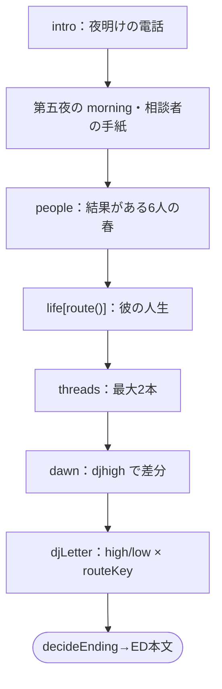

[index.html](../../index.html) L1306 `playEpilogue()`。peopleの対象は `ol, salaryman, musician, grandpa, mother, madam`。結果のない人物はスキップし、ある人物はそのgood/mid/badの本文を使います。人生は常に `life[route()]` で、ナツメも `life.alone` 内の差分です。

| routeKey | 深い糸の候補（実装の優先順） | 枠 |
| --- | --- | --- |
| nanami | T1 → T4 → T7 → T3 | 成立候補から最大2本 |
| haruka | T6 → T4 → T7 → T3 | 成立候補から最大2本 |
| natsume | T3 → T7 | N1必須＋成立候補から最大1本 |
| alone | T7 → T3 → T1 → T4 → T6 | 成立候補から最大2本 |

候補は `tieOn(k) && E.threads[k]` で絞り、localStorage `shinyaSoudanThreads` の未読を先、既読を後へ並べます。単に糸が成立しただけでは、その周に深いエピソードが出るとは限りません。T2・T5・T8には独立のthreads本文がなく、人生側で描かれます。

ナツメの手紙は `dj ≥ 16` でhigh／low、`routeKey()` で4種類に分岐。該当キーがなければ `high/low + G.route`、さらにhigh/lowへフォールバックします。通常の相談者の手紙は `結果_route()` があれば優先し、なければ結果のみを使います（[index.html](../../index.html) L1226 `morningLetters()`）。

## 相談結果 good / mid / bad

[index.html](../../index.html) L989 `applyChoice()`、[index.html](../../index.html) L1008 `resultOf()`。各相談者の開始時に距離m・返答数n・良い返答数gを0へ初期化します。

- freeでない相談者カードだけ n を1加算。just、またはoddかつgoodがfalseでないカードは g も1加算。
- 数値 m 指定があれば加算。なければnearは−2、farは＋2、良い返答は0へ最大2だけ近づく。毎回−8〜8に制限。
- n=0 はmid。次に g ≥ n−1 かつ |m| ≤ 2 ならgood。次に g ≤ floor(n/3) または |m| ≥ 5 ならbad。残りはmid。goodの判定が先です。
- actsは実エンジンでfree:trueへ変換され採点されません。freeでもset/dj/cat指定があれば適用されます。memoカードは回収済みのことばとif条件で表示され、採点は通常カードと同じです。

## 仕事・人生への状態依存

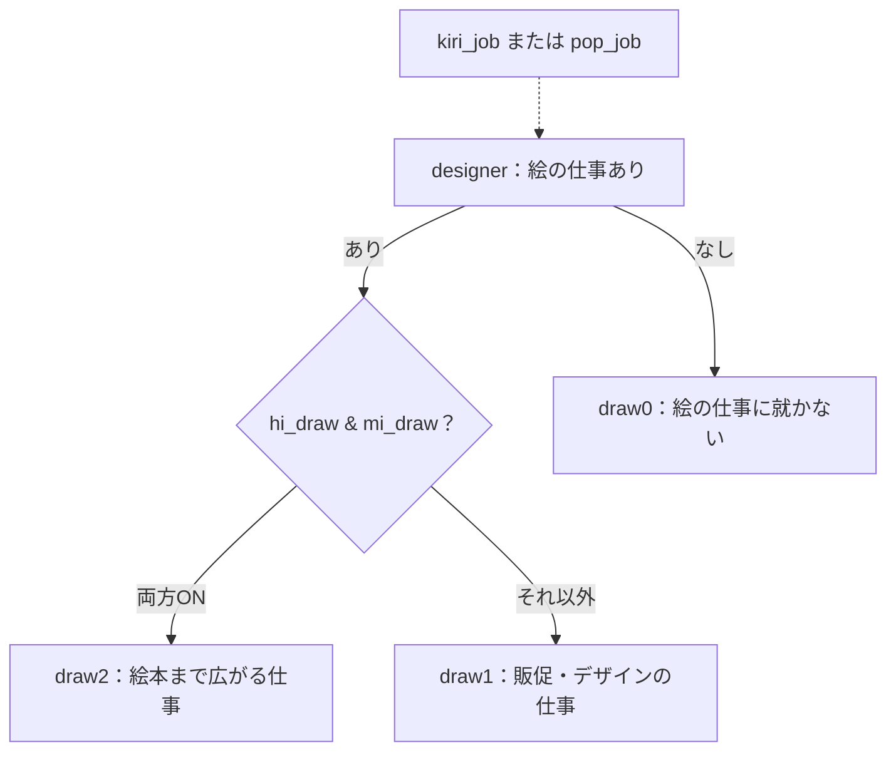

`pop_job = konbini結果あり & route:haruka & !kiri_job`。`sayno = hi_no OR mi_no` は断る言葉の差分で、独立の人生ルートではありません。根拠：[index.html](../../index.html) L570 `popJob()`、[index.html](../../index.html) L571 `designer()`、[index.html](../../index.html) L572 `drawLevel()`、[epilogue2.js の WORK_NOW / WORK_LATER](../../story/epilogue2.js)、[BIBLE §3・§6](../../story/BIBLE.md)。draw0の図は全人生共通の定義です。haruka内の到達不能な側は下の位置別の判定を参照してください。

#### 春の本文の条件側（1）

移動先が同じ会話差分も、条件の片側として表示しています。図の番号は下表に対応します。

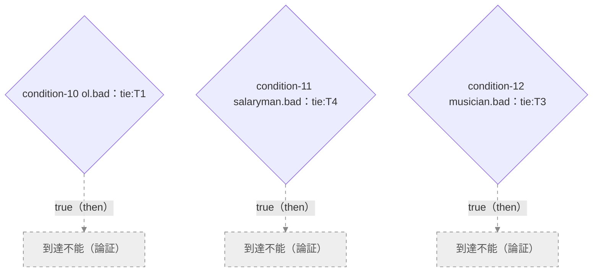

| 番号・参照位置 | 条件側 | 状態・検証行 |
| --- | --- | --- |
| `condition-10` [story/epilogue.js](../../story/epilogue.js) · `epilogue.people.ol.bad.5` | `tie:T1 = true` | [到達不能（論証）](30_検証と要確認.md#condition-10) |
| `condition-11` [story/epilogue.js](../../story/epilogue.js) · `epilogue.people.salaryman.bad.5` | `tie:T4 = true` | [到達不能（論証）](30_検証と要確認.md#condition-11) |
| `condition-12` [story/epilogue.js](../../story/epilogue.js) · `epilogue.people.musician.bad.5` | `tie:T3 = true` | [到達不能（論証）](30_検証と要確認.md#condition-12) |

#### 春の本文の条件側（2）

移動先が同じ会話差分も、条件の片側として表示しています。図の番号は下表に対応します。

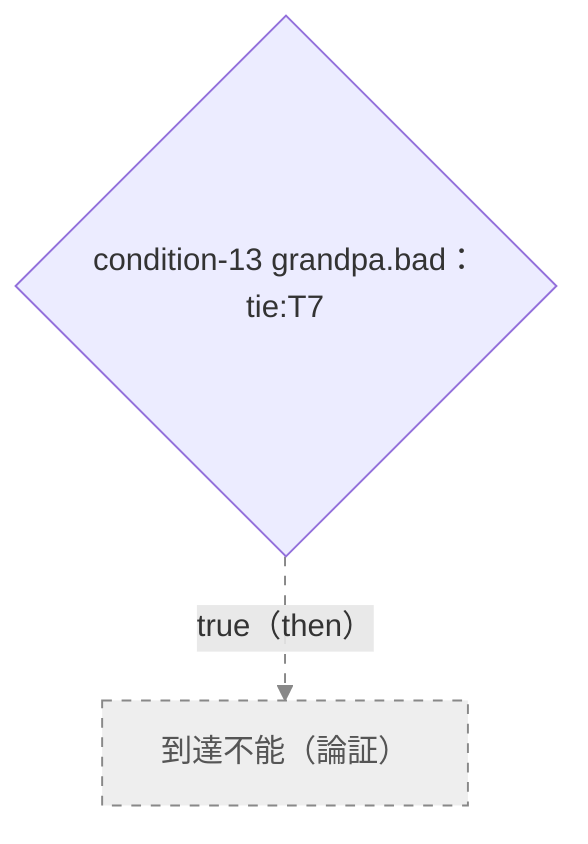

| 番号・参照位置 | 条件側 | 状態・検証行 |
| --- | --- | --- |
| `condition-13` [story/epilogue.js](../../story/epilogue.js) · `epilogue.people.grandpa.bad.5` | `tie:T7 = true` | [到達不能（論証）](30_検証と要確認.md#condition-13) |

#### 深い糸の条件側

移動先が同じ会話差分も、条件の片側として表示しています。図の番号は下表に対応します。

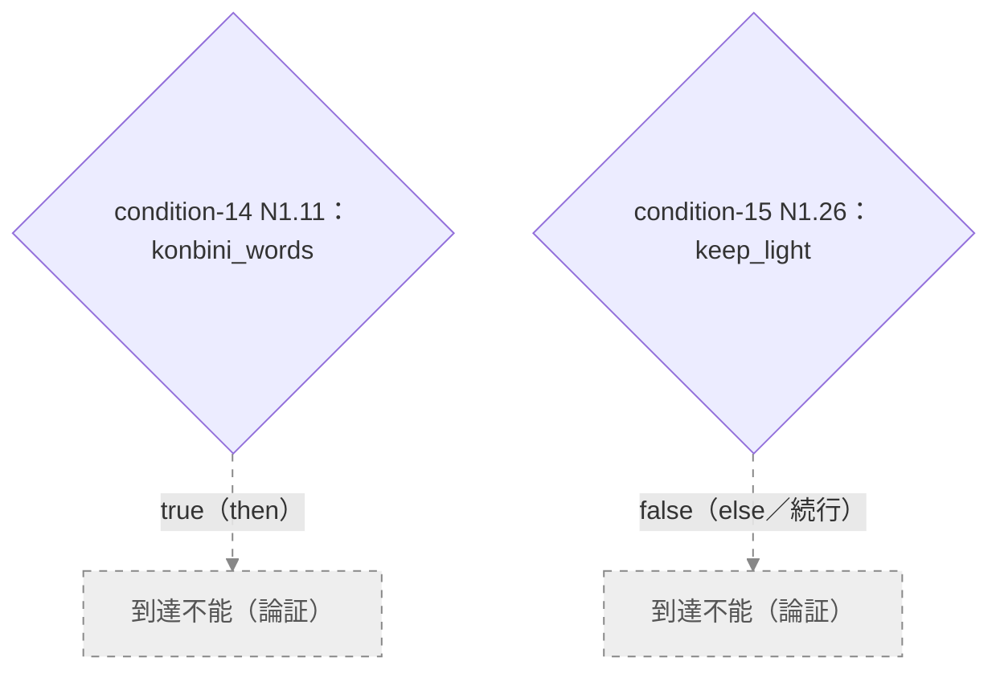

| 番号・参照位置 | 条件側 | 状態・検証行 |
| --- | --- | --- |
| `condition-14` [story/epilogue.js](../../story/epilogue.js) · `epilogue.threads.N1.11` | `konbini_words = true` | [到達不能（論証）](30_検証と要確認.md#condition-14) |
| `condition-15` [story/epilogue.js](../../story/epilogue.js) · `epilogue.threads.N1.26` | `keep_light = false` | [到達不能（論証）](30_検証と要確認.md#condition-15) |

#### 人生本文の条件側

移動先が同じ会話差分も、条件の片側として表示しています。図の番号は下表に対応します。

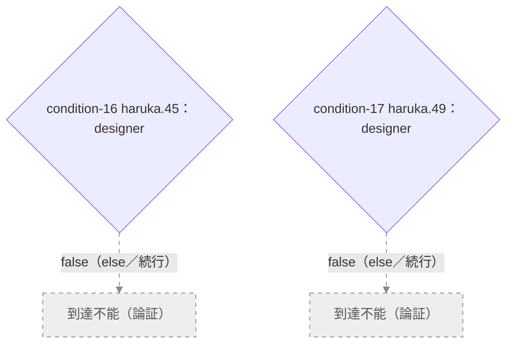

| 番号・参照位置 | 条件側 | 状態・検証行 |
| --- | --- | --- |
| `condition-16` [story/epilogue2.js](../../story/epilogue2.js) · `epilogue.life.haruka.45` | `designer = false` | [到達不能（論証）](30_検証と要確認.md#condition-16) |
| `condition-17` [story/epilogue2.js](../../story/epilogue2.js) · `epilogue.life.haruka.49.else.0.then.1` | `designer = false` | [到達不能（論証）](30_検証と要確認.md#condition-17) |

#### ED本文の条件側

移動先が同じ会話差分も、条件の片側として表示しています。図の番号は下表に対応します。

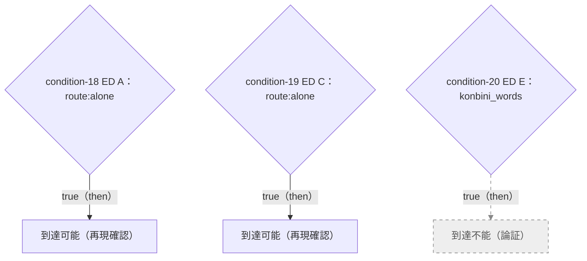

| 番号・参照位置 | 条件側 | 状態・検証行 |
| --- | --- | --- |
| `condition-18` [story/epilogue3.js](../../story/epilogue3.js) · `epilogue.endings.A.script.19` | `route:alone = true` | [到達可能（再現確認）](30_検証と要確認.md#condition-18) |
| `condition-19` [story/epilogue3.js](../../story/epilogue3.js) · `epilogue.endings.C.script.11` | `route:alone = true` | [到達可能（再現確認）](30_検証と要確認.md#condition-19) |
| `condition-20` [story/epilogue3.js](../../story/epilogue3.js) · `epilogue.endings.E.script.2.else.0` | `konbini_words = true` | [到達不能（論証）](30_検証と要確認.md#condition-20) |

## ルート別EDの状態

| routeKey / ED | 状態 |
| --- | --- |
| `nanami/A` | [到達可能（再現確認）](30_検証と要確認.md#ending-nanami-A) |
| `nanami/B` | [到達可能（再現確認）](30_検証と要確認.md#ending-nanami-B) |
| `nanami/C` | [到達可能（再現確認）](30_検証と要確認.md#ending-nanami-C) |
| `nanami/D` | [到達可能（再現確認）](30_検証と要確認.md#ending-nanami-D) |
| `nanami/E` | [到達不能（論証）](30_検証と要確認.md#ending-nanami-E) |
| `haruka/A` | [到達可能（再現確認）](30_検証と要確認.md#ending-haruka-A) |
| `haruka/B` | [到達可能（再現確認）](30_検証と要確認.md#ending-haruka-B) |
| `haruka/C` | [到達可能（再現確認）](30_検証と要確認.md#ending-haruka-C) |
| `haruka/D` | [到達可能（再現確認）](30_検証と要確認.md#ending-haruka-D) |
| `haruka/E` | [到達不能（論証）](30_検証と要確認.md#ending-haruka-E) |
| `alone/A` | [到達可能（再現確認）](30_検証と要確認.md#ending-alone-A) |
| `alone/B` | [到達可能（再現確認）](30_検証と要確認.md#ending-alone-B) |
| `alone/C` | [到達可能（再現確認）](30_検証と要確認.md#ending-alone-C) |
| `alone/D` | [到達可能（再現確認）](30_検証と要確認.md#ending-alone-D) |
| `alone/E` | [到達不能（論証）](30_検証と要確認.md#ending-alone-E) |
| `natsume/A` | [到達不能（論証）](30_検証と要確認.md#ending-natsume-A) |
| `natsume/B` | [到達可能（再現確認）](30_検証と要確認.md#ending-natsume-B) |
| `natsume/C` | [到達不能（論証）](30_検証と要確認.md#ending-natsume-C) |
| `natsume/D` | [到達可能（再現確認）](30_検証と要確認.md#ending-natsume-D) |
| `natsume/E` | [到達可能（再現確認）](30_検証と要確認.md#ending-natsume-E) |
