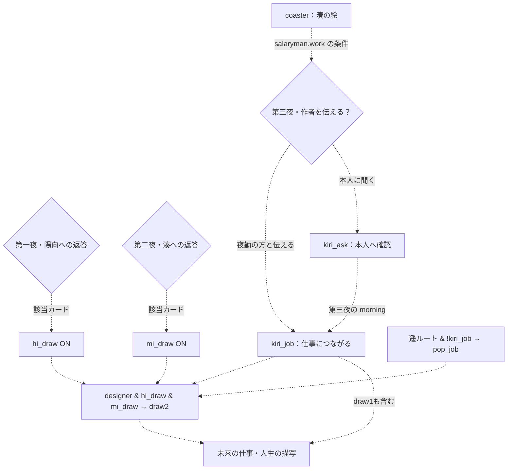
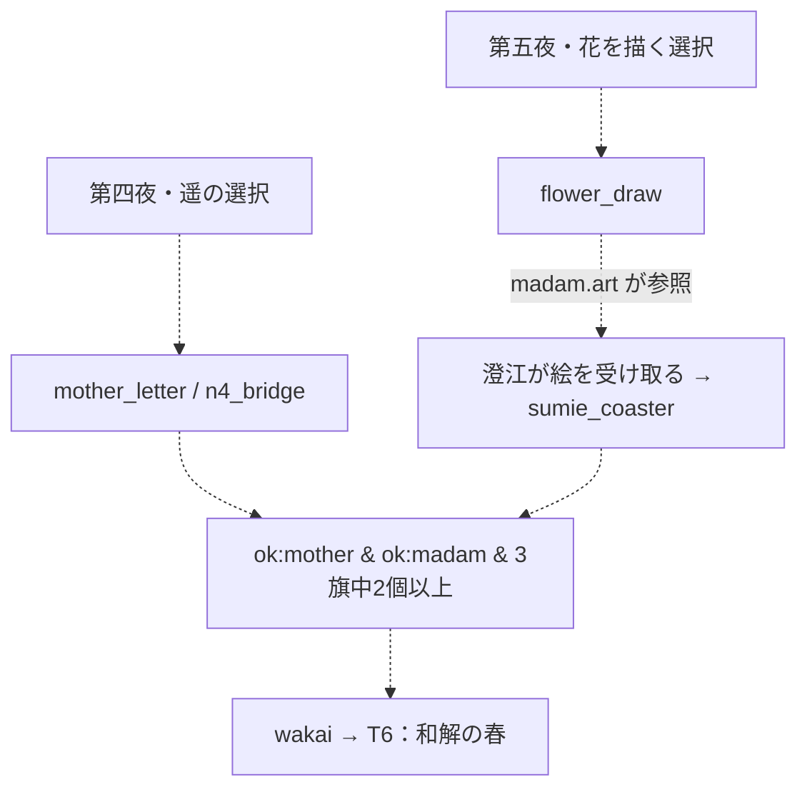
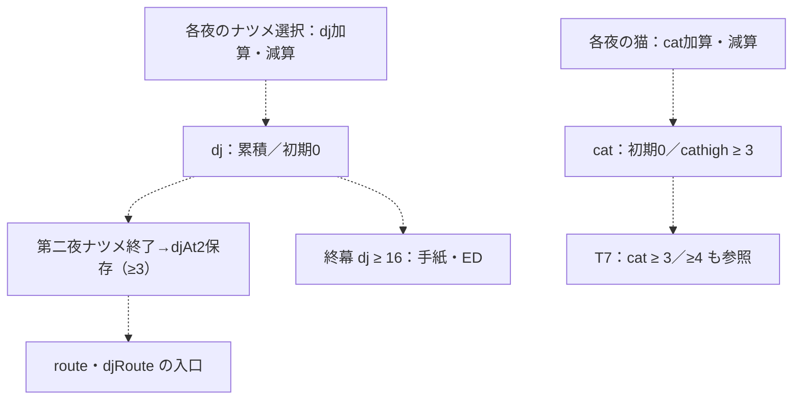

# フラグ・数値の依存関係

> 自動生成：`node tools/generate-branchmaps.js`。実装の動作を記述。ネタバレを含みます。

[[00_全体マップ|全体へ]]

矢印は因果の読み方です。実際の進行順は夜別図を参照してください。フラグはSetへの追加のみで、現在のシナリオに解除処理はありません。表は代表参照を最大3か所に絞り、全件は [[details/条件索引|条件・状態索引]] と [機械可読モデル](data/branch-model.json) に残しています。

## 絵を持ち続けることと仕事

`hi_draw` だけで仕事やdraw2は確定しません。`designer()` は仕事の入口、`hi_draw & mi_draw` はdraw2への追加条件です。コースターは `konbini.script.regulars` の選択で残り、`salaryman.script.work` で仕事の話を開きます。物語の仕事差分は [epilogue2.js WORK_NOW / WORK_LATER](../../story/epilogue2.js)。

## 遥・澄江の和解

`sumie_coaster` 単独では和解しません。`mother_letter` または `n4_bridge`、両者の相談結果も必要です。根拠：[index.html](../../index.html) L574 `wakai()`、[madam.js art](../../story/madam.js)、[BIBLE §3・§11](../../story/BIBLE.md)。

## 数値・閾値

各カードの増減量は夜別表に表示しています。dj・cat自体に上下限のクランプはありません。相談者の距離メーターだけ−8〜8です。実測した最終値の範囲は理論上の上下限ではありません。

| 状態 | 設定・加算 | 主な参照 |
| --- | --- | --- |
| dj | applyChoice / runSteps の dj 数値を加算 | djhigh ≥ 16、djRoute入口の保存元、各夜のdj閾値会話 |
| djAt2 | 第二夜 runFrameSeg(dj) 終了時に dj を代入 | djAt2High ≥ 3。以後のdj増減で変わらない |
| cat | 各夜の猫カードの数値を加算 | cathigh ≥ 3、T7の二段階閾値 3/4 |
| meters / counts | 相談者ごとに初期化。距離・n・gを更新 | resultOf → good/mid/bad → 手紙・糸・会話 |
| res[ID] | 相談者のscript終了後 resultOf(id) | good/mid/bad/ok、route、tieOn、peopleと手紙 |
| memos | 光ることばをタップしたとき回収。自動回収ではない | choice.memo が表示条件。通常カードの代替を増やす |
| shinyaSoudanThreads | 見た深い糸を周回間で保存 | 未読優先。人生ルートやED自体には影響しない |

## 設定箇所と参照箇所

| フラグ | 設定元（代表） | 参照元（代表／判定関数） |
| --- | --- | --- |
| `child_tell` | [story/child.js](../../story/child.js) · `visitors.child.script.moon.16.choice.4` | [story/child.js](../../story/child.js) · `visitors.child.script.moon.21` [story/freelance.js](../../story/freelance.js) · `visitors.freelance.script.h2.10` [story/freelance.js](../../story/freelance.js) · `visitors.freelance.script.h3.8` |
| `coaster` | [story/konbini.js](../../story/konbini.js) · `visitors.konbini.script.regulars.32.choice.1` | [story/frame2.js](../../story/frame2.js) · `nights.2.morning.0` [story/konbini.js](../../story/konbini.js) · `visitors.konbini.script.draw.2` [story/konbini.js](../../story/konbini.js) · `visitors.konbini.script.tell.2` |
| `dj_ice` | [story/frame1.js](../../story/frame1.js) · `nights.1.dj.script.start.43.choice.0` | [story/frame1.js](../../story/frame1.js) · `nights.1.scenes.walk1.script.start.30` [story/frame2.js](../../story/frame2.js) · `nights.2.dj.script.start.45` [story/frame3.js](../../story/frame3.js) · `nights.3.dj.script.radio.3` |
| `dj_mug` | [story/frame2.js](../../story/frame2.js) · `nights.2.dj.script.start.50.choice.0` | [story/frame2.js](../../story/frame2.js) · `nights.2.monologue.12` [story/frame3.js](../../story/frame3.js) · `nights.3.dj.script.start.39` [story/frame4.js](../../story/frame4.js) · `nights.4.scenes.kozue4.script.start.62.then.1` |
| `dj_snow5` | [story/frame5.js](../../story/frame5.js) · `nights.5.scenes.snow5.script.start.14.choice.0` | [story/frame5.js](../../story/frame5.js) · `nights.5.scenes.snow5.script.start.26` |
| `dj_song` | [story/frame1.js](../../story/frame1.js) · `nights.1.dj.script.start.64.choice.1` | [story/frame2.js](../../story/frame2.js) · `nights.2.dj.script.start.25` [story/frame3.js](../../story/frame3.js) · `nights.3.dj.script.radio.3.else.0` |
| `dj_umbrella` | [story/frame3.js](../../story/frame3.js) · `nights.3.dj.script.talk.27.choice.1` | [story/frame3.js](../../story/frame3.js) · `nights.3.morning.5` [story/frame4.js](../../story/frame4.js) · `nights.4.dj.script.start.1` |
| `dj_walk` | [story/frame3.js](../../story/frame3.js) · `nights.3.dj.script.talk.27.choice.1` | [story/frame3.js](../../story/frame3.js) · `nights.3.dj.script.door.5` |
| `dj_walk1` | [story/frame1.js](../../story/frame1.js) · `nights.1.scenes.walk1.script.start.24.choice.1` | [story/frame1.js](../../story/frame1.js) · `nights.1.scenes.walk1.script.start.46` |
| `dj_walk2_lemon` | [story/frame2.js](../../story/frame2.js) · `nights.2.scenes.walk2.script.start.37.choice.1` | [story/frame3.js](../../story/frame3.js) · `nights.3.scenes.sign3.script.start.9` |
| `dj_walk2_star` | [story/frame2.js](../../story/frame2.js) · `nights.2.scenes.walk2.script.start.37.choice.0` | [story/frame3.js](../../story/frame3.js) · `nights.3.scenes.sign3.script.start.9` |
| `dj_walk4` | [story/frame4.js](../../story/frame4.js) · `nights.4.scenes.moonwalk4.script.start.39.choice.0` | [story/frame5.js](../../story/frame5.js) · `nights.5.scenes.snow5.script.start.13` |
| `draw_a` | [story/konbini.js](../../story/konbini.js) · `visitors.konbini.script.regulars.32.choice.0` | [story/konbini.js](../../story/konbini.js) · `visitors.konbini.script.tell.2.else.0` |
| `flower_draw` | [story/frame5.js](../../story/frame5.js) · `nights.5.scenes.miyoshi.script.sumie.29.else.1.choice.0` | [story/frame5.js](../../story/frame5.js) · `nights.5.monologue.6` [story/madam.js](../../story/madam.js) · `visitors.madam.script.art.5` [story/epilogue2.js](../../story/epilogue2.js) · `epilogue.life.haruka.46.then.0` |
| `freelance_no` | [story/freelance.js](../../story/freelance.js) · `visitors.freelance.script.h3.11.choice.2` [story/freelance.js](../../story/freelance.js) · `visitors.freelance.script.n3.10.choice.0` [story/freelance.js](../../story/freelance.js) · `visitors.freelance.script.a3.11.choice.0` | [story/freelance.js](../../story/freelance.js) · `visitors.freelance.script.hEnd.3` [story/freelance.js](../../story/freelance.js) · `visitors.freelance.script.nEnd.3` [story/freelance.js](../../story/freelance.js) · `visitors.freelance.script.aEnd.3` |
| `grandpa_call` | [story/grandpa.js](../../story/grandpa.js) · `visitors.grandpa.script.takano.17.choice.3` | [story/frame4.js](../../story/frame4.js) · `nights.4.monologue.4.then.1` [story/mother.js](../../story/mother.js) · `visitors.mother.script.moon.6` [story/frame5.js](../../story/frame5.js) · `nights.5.scenes.miyoshi.script.sumie.11` |
| `grandpa_one` | [story/grandpa.js](../../story/grandpa.js) · `visitors.grandpa.script.last.5.choice.1` | [story/frame3.js](../../story/frame3.js) · `nights.3.cat.script.start.29` [story/epilogue.js](../../story/epilogue.js) · `epilogue.intro.57` [story/epilogue.js](../../story/epilogue.js) · `epilogue.people.grandpa.good.3` |
| `hi_draw` | [story/student.js](../../story/student.js) · `visitors.student.script.paper.14.choice.1` | [story/student.js](../../story/student.js) · `visitors.student.script.leave.4` [story/konbini.js](../../story/konbini.js) · `visitors.konbini.script.draw.2.else.0` [story/epilogue.js](../../story/epilogue.js) · `epilogue.threads.T4.40` [index.html](../../index.html) L572 `drawLevel()` |
| `hi_no` | [story/student.js](../../story/student.js) · `visitors.student.script.requests.19.choice.3` | [story/student.js](../../story/student.js) · `visitors.student.script.leave.5` [story/konbini.js](../../story/konbini.js) · `visitors.konbini.script.shift.5.choice.0.r.4` [story/epilogue2.js](../../story/epilogue2.js) · `epilogue.life.nanami.18` [index.html](../../index.html) L580 `evalTok()` |
| `hi_song` | [story/student.js](../../story/student.js) · `visitors.student.script.night.40.choice.1` | [story/student.js](../../story/student.js) · `visitors.student.script.leave.3` [story/konbini.js](../../story/konbini.js) · `visitors.konbini.script.regulars.15` [story/musician.js](../../story/musician.js) · `visitors.musician.script.start.34` |
| `keep_light` | [story/frame5.js](../../story/frame5.js) · `nights.5.dj.script.keep.9.choice.2` | [story/epilogue.js](../../story/epilogue.js) · `epilogue.threads.N1.26` |
| `kiri_ask` | [story/salaryman.js](../../story/salaryman.js) · `visitors.salaryman.script.coaster.25.choice.1` | [story/frame3.js](../../story/frame3.js) · `nights.3.morning.11` [story/frame5.js](../../story/frame5.js) · `nights.5.scenes.miyoshi.script.start.29` [story/epilogue.js](../../story/epilogue.js) · `epilogue.threads.T4.3` |
| `kiri_job` | [story/salaryman.js](../../story/salaryman.js) · `visitors.salaryman.script.coaster.25.choice.0` [story/frame3.js](../../story/frame3.js) · `nights.3.morning.11.then.5` | [story/frame3.js](../../story/frame3.js) · `nights.3.monologue.7` [story/mother.js](../../story/mother.js) · `visitors.mother.script.start.39.then.6` [story/frame5.js](../../story/frame5.js) · `nights.5.scenes.miyoshi.script.start.29.else.0` [index.html](../../index.html) L541 `tieOn()` [index.html](../../index.html) L570 `popJob()` [index.html](../../index.html) L571 `designer()` |
| `konbini_words` | [story/konbini.js](../../story/konbini.js) · `visitors.konbini.script.words.17.choice.4` | [story/frame2.js](../../story/frame2.js) · `nights.2.dj.script.start.31` [story/konbini.js](../../story/konbini.js) · `visitors.konbini.script.leave.15` [story/salaryman.js](../../story/salaryman.js) · `visitors.salaryman.script.start.19` [index.html](../../index.html) L554 `route()` |
| `kozue_tea` | [story/musician.js](../../story/musician.js) · `visitors.musician.script.start.40.choice.3` | [story/musician.js](../../story/musician.js) · `visitors.musician.script.songs.1` [story/musician.js](../../story/musician.js) · `visitors.musician.script.last.14` [story/frame4.js](../../story/frame4.js) · `nights.4.scenes.kozue4.script.start.99` |
| `madam_go` | [story/madam.js](../../story/madam.js) · `visitors.madam.script.last.8.choice.4` | [story/madam.js](../../story/madam.js) · `visitors.madam.script.leave.9` [story/epilogue.js](../../story/epilogue.js) · `epilogue.people.mother.good.4` |
| `mi_draw` | [story/konbini.js](../../story/konbini.js) · `visitors.konbini.script.draw.2.else.0.else.7.choice.0` |  [index.html](../../index.html) L572 `drawLevel()` |
| `mi_no` | [story/konbini.js](../../story/konbini.js) · `visitors.konbini.script.shift.5.choice.0` | [story/konbini.js](../../story/konbini.js) · `visitors.konbini.script.leave.16` [story/epilogue2.js](../../story/epilogue2.js) · `epilogue.life.alone.34` [index.html](../../index.html) L580 `evalTok()` |
| `mi_rush` | [story/konbini.js](../../story/konbini.js) · `visitors.konbini.script.tell.30.choice.2` | [story/konbini.js](../../story/konbini.js) · `visitors.konbini.script.words.14.else.0` [story/konbini.js](../../story/konbini.js) · `visitors.konbini.script.leave.14` [story/epilogue2.js](../../story/epilogue2.js) · `epilogue.life.haruka.31` [index.html](../../index.html) L554 `route()` |
| `mi_tell` | [story/konbini.js](../../story/konbini.js) · `visitors.konbini.script.tell.30.choice.1` | [story/konbini.js](../../story/konbini.js) · `visitors.konbini.script.words.14` [story/konbini.js](../../story/konbini.js) · `visitors.konbini.script.leave.14.else.0` [story/epilogue2.js](../../story/epilogue2.js) · `epilogue.life.haruka.31.else.0` [index.html](../../index.html) L554 `route()` |
| `mother_letter` | [story/mother.js](../../story/mother.js) · `visitors.mother.script.last.7.choice.4` | [story/frame4.js](../../story/frame4.js) · `nights.4.monologue.4.else.2` [story/epilogue.js](../../story/epilogue.js) · `epilogue.people.madam.good.3` [index.html](../../index.html) L574 `wakai()` |
| `musician_song` | [story/musician.js](../../story/musician.js) · `visitors.musician.script.song.11.choice.4` | [story/frame2.js](../../story/frame2.js) · `nights.2.monologue.6` [story/musician.js](../../story/musician.js) · `visitors.musician.script.last.6` [story/frame4.js](../../story/frame4.js) · `nights.4.scenes.kozue4.script.start.61` |
| `n4_bridge` | [story/mother.js](../../story/mother.js) · `visitors.mother.script.sumie.48.choice.1` | [story/frame4.js](../../story/frame4.js) · `nights.4.scenes.alt4.script.start.20.else.3.then.1` [story/mother.js](../../story/mother.js) · `visitors.mother.script.sumie.63` [index.html](../../index.html) L574 `wakai()` |
| `ol_words` | [story/ol.js](../../story/ol.js) · `visitors.ol.script.part3.22.choice.4` | [story/ol.js](../../story/ol.js) · `visitors.ol.script.leave.13` [story/salaryman.js](../../story/salaryman.js) · `visitors.salaryman.script.buka.14.else.0.then.2` [story/freelance.js](../../story/freelance.js) · `visitors.freelance.script.n3.4` |
| `salary_tell` | [story/salaryman.js](../../story/salaryman.js) · `visitors.salaryman.script.tell.10.choice.1` | [story/salaryman.js](../../story/salaryman.js) · `visitors.salaryman.script.leave.6` [story/frame3.js](../../story/frame3.js) · `nights.3.monologue.5` [story/freelance.js](../../story/freelance.js) · `visitors.freelance.script.h3.5` |
| `sumie_coaster` | [story/madam.js](../../story/madam.js) · `visitors.madam.script.coaster.10` | [story/madam.js](../../story/madam.js) · `visitors.madam.script.last.3` [story/madam.js](../../story/madam.js) · `visitors.madam.script.leave.6` [story/epilogue.js](../../story/epilogue.js) · `epilogue.people.madam.good.4` [index.html](../../index.html) L574 `wakai()` |
| `told_date` | [story/frame5.js](../../story/frame5.js) · `nights.5.scenes.miyoshi.script.haruka.27.choice.0` | [story/frame5.js](../../story/frame5.js) · `nights.5.monologue.12` [story/epilogue2.js](../../story/epilogue2.js) · `epilogue.life.haruka.56` |
| `told_soft` | [story/frame5.js](../../story/frame5.js) · `nights.5.scenes.miyoshi.script.haruka.27.choice.1` | [story/frame5.js](../../story/frame5.js) · `nights.5.monologue.12` [story/epilogue2.js](../../story/epilogue2.js) · `epilogue.life.haruka.56.else.0` |

## 設定されるが参照のないフラグ

物語本文の文字列に名前があるだけのものは状態参照に数えません。以下は現行読み込みファイルと判定関数を調べた結果です。

| フラグ | 設定箇所 | 評価 |
| --- | --- | --- |
| `dj_candle` | [story/frame4.js](../../story/frame4.js) · `nights.4.dj.script.candle.1` | 参照箇所なし。保存・デバッグ表示には残る。削除していない |

## 参照されるが設定元のない状態名

通常フラグの条件トークンでは見つかりませんでした。route・draw・ok・tieなどの派生条件は、対応関数で計算されるためset元を持ちません。

## メモと選択肢の依存

ことばを見ただけでは回収されません。タップして回収したとき、そのmemoを要求するカードが表示されます。`memo` と `if` が両方あれば両方が必要です。すべてのカードが非表示になった場合、実エンジンは元の全カードに戻すため、この例外も検証モデルに合わせています。

| memo | 出現箇所 | 参照するカード数 |
| --- | --- | --- |
| `ol_period` | [story/ol.js](../../story/ol.js) · `visitors.ol.script.part3.1` | 2 |
| `ol_stamp` | [story/ol.js](../../story/ol.js) · `visitors.ol.script.part3.17` | 1 |
| `student_hashi` | [story/student.js](../../story/student.js) · `visitors.student.script.paper.12` | 1 |
| `konbini_koe` | [story/konbini.js](../../story/konbini.js) · `visitors.konbini.script.start.57` | 1 |
| `konbini_seal` | [story/konbini.js](../../story/konbini.js) · `visitors.konbini.script.tell.6` | 1 |
| `salaryman_okotte` | [story/salaryman.js](../../story/salaryman.js) · `visitors.salaryman.script.buka.15` | 1 |
| `salaryman_yonjuppun` | [story/salaryman.js](../../story/salaryman.js) · `visitors.salaryman.script.tell.3` | 1 |
| `musician_uku` | [story/musician.js](../../story/musician.js) · `visitors.musician.script.start.35` | 1 |
| `musician_kuuki` | [story/musician.js](../../story/musician.js) · `visitors.musician.script.songs.6` | 1 |
| `grandpa_jadou` | [story/grandpa.js](../../story/grandpa.js) · `visitors.grandpa.script.start.60` | 1 |
| `mother_hasami` | [story/mother.js](../../story/mother.js) · `visitors.mother.script.start.53` | 1 |
| `child_light` | [story/child.js](../../story/child.js) · `visitors.child.script.start.28` | 1 |
| `freelance_kuma` | [story/freelance.js](../../story/freelance.js) · `visitors.freelance.script.h1.20` | 1 |
| `freelance_tower` | [story/freelance.js](../../story/freelance.js) · `visitors.freelance.script.n1.2` | 1 |
| `freelance_mikka` | [story/freelance.js](../../story/freelance.js) · `visitors.freelance.script.a1.4` | 1 |
| `madam_iede` | [story/madam.js](../../story/madam.js) · `visitors.madam.script.young.2` | 1 |

