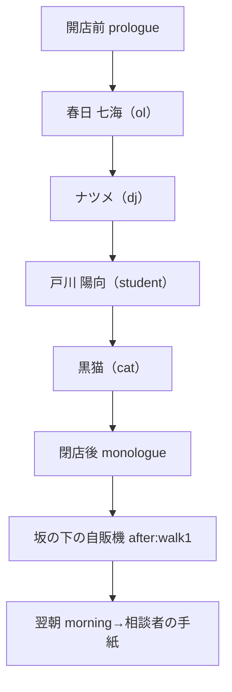
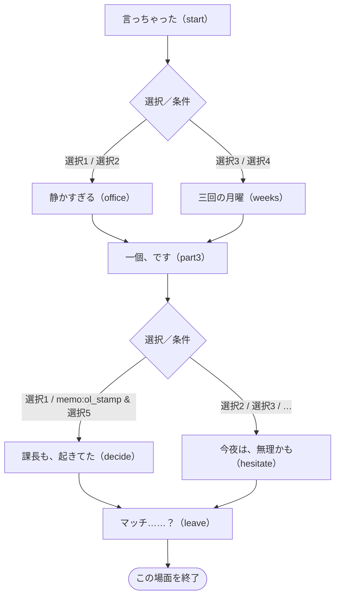
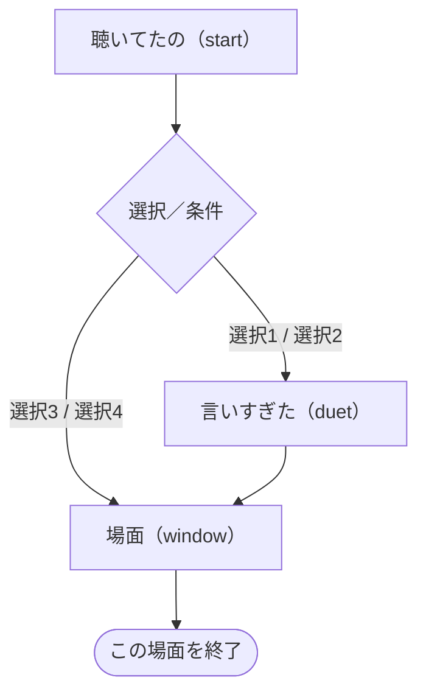
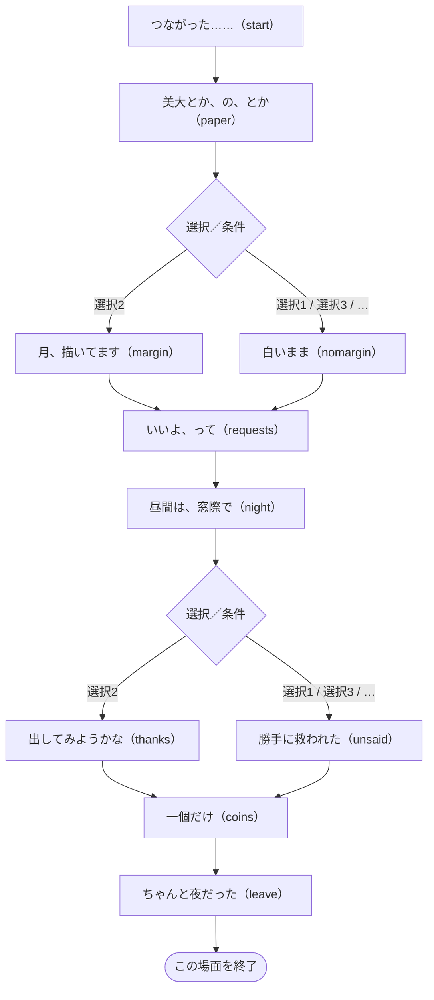

# 第一夜 — 細い月と、ふたつめの角砂糖

> 自動生成：`node tools/generate-branchmaps.js`。実装の動作を記述。ネタバレを含みます。

[[../00_全体マップ|全体へ]] · [[../10_ルートとED|判定の詳細]]

## この夜の進行

根拠：[story/frame1.js](../../../story/frame1.js) · `nights.1` の `order / after / prologue / monologue / morning`。

## 場面ごとの分岐

ノードは短い場面の言葉とコード内のラベル名です。図の選択番号は該当choice/acts内の1始まり、表の先頭番号はscript全体でのカード群の通し番号（acts含む）です。ソース内位置で照合できます。同じ移動先は合流させています。表示条件の「制限なし」は、そのラベル・外側の条件を通ってカード群が実行されている場合を指します。状態を変える選択は表を優先して確認してください。全条件の正確な配列位置は [[../details/条件索引|条件索引]] と `data/branch-model.json` にあります。

### 後の展開への影響

`ol_words` は七海の言葉と後の既読の描写、`hi_draw` は三好の絵を持ち続ける描写とdraw判定、`hi_song` は梢との歌・葉書の差分へつながります。独立した人生ルートはこの夜だけでは決まりません。 根拠と参照先は [[../20_フラグ依存関係|フラグ依存関係]]・[[../details/条件索引|全参照索引]] にあります。

### 春日 七海（ol）

[story/ol.js](../../../story/ol.js) · `visitors.ol.script`。

| 選択群-カード・短い文言 | 表示条件 | 状態変化 | 移動 | ソース内位置 |
| --- | --- | --- | --- | --- |
| 3-1 上司からの連絡なら、早めに開いて返したほうがいいかも… | 制限なし | 距離:far | `office` | `start.41.choice.0` |
| 3-2 わかります！　わたしも、上司からの通知って本当に怖く… | 制限なし | 距離:near | `office` | `start.41.choice.1` |
| 3-3 来週でいい、の来週を、三回見送ったんですね | 制限なし | 距離:just | `weeks` | `start.41.choice.2` |
| 3-4 （黙って、ホットミルクの膜をスプーンでそっとすくう） | 制限なし | 距離:odd | `weeks` | `start.41.choice.3` |
| 5-1 既読は返事じゃなくて、届いたよって合図くらいでも、い… | 制限なし | ol_words ON / 距離:just | `decide` | `part3.22.choice.0` |
| 5-2 返事の文面、いっしょに考えましょうか。なんなら下書き… | 制限なし | 距離:near | `hesitate` | `part3.22.choice.1` |
| 5-3 でも、仕事の連絡を三週間未読というのは、さすがに…… | 制限なし | 距離:far | `hesitate` | `part3.22.choice.2` |
| 5-4 （黒電話を指さして）あれには、既読も未読もないんです… | 制限なし | 距離:odd | `hesitate` | `part3.22.choice.3` |
| 5-5 お母さんの猫のスタンプみたいに、既読も、生きてますの… | `memo:ol_stamp` | ol_words ON / 距離:just | `decide` | `part3.22.choice.4` |
| 7-1 開くのは、杏仁豆腐を食べてからでも、遅くないと思います | 制限なし | 距離:just | `leave` | `decide.13.choice.0` |
| 7-2 じゃあ、今ここで開きましょう。わたしが横で見ています… | 制限なし | 距離:near | `leave` | `decide.13.choice.1` |
| 7-3 決めたなら、もう大丈夫ですね | 制限なし | 距離:far | `leave` | `decide.13.choice.2` |
| 7-4 （スプーンを一本、カウンターにそっと置く） | 制限なし | 距離:odd | `leave` | `decide.13.choice.3` |
| 7-5 今日の句読点を打ってからなら、明日の一行目として開け… | `memo:ol_period` | 距離:just | `leave` | `decide.13.choice.4` |
| 9-1 画面が暗くなるまで、毎晩ちゃんと迷ってきたんですね | 制限なし | 距離:just | `leave` | `hesitate.11.choice.0` |
| 9-2 大丈夫、きっといい話ですよ。わたしが保証します | 制限なし | 距離:near | `leave` | `hesitate.11.choice.1` |
| 9-3 最終的には、春日さんが決めることですから | 制限なし | 距離:far | `leave` | `hesitate.11.choice.2` |
| 9-4 （何も言わずに、冷めたホットミルクを温め直す） | 制限なし | 距離:odd | `leave` | `hesitate.11.choice.3` |
| 9-5 今夜は句読点だけ打って、続きは明日の行にまわしても | `memo:ol_period` | 距離:just | `leave` | `hesitate.11.choice.4` |

簡略化：acts 3群（採点なし）、直接の状態・移動指定がない通常カード 2群（相談者なら距離・結果には影響）。共通の採点式は [[../10_ルートとED#相談結果 good / mid / bad|相談結果]]。

参照する状態・条件：`ol_words`。会話差分も含み、すべてが移動分岐になるわけではありません。

### ナツメ（dj）

[story/frame1.js](../../../story/frame1.js) · `nights.1.dj.script`。

| 選択群-カード・短い文言 | 表示条件 | 状態変化 | 移動 | ソース内位置 |
| --- | --- | --- | --- | --- |
| 1-1 （氷をひとつだけ、豆皿にのせて添える） | 制限なし | dj_ice ON / dj +2 | 反応後に続行／合流 | `start.43.choice.0` |
| 1-2 次からは、ぬるめに淹れておきますね | 制限なし | dj +0 | 反応後に続行／合流 | `start.43.choice.1` |
| 1-3 珈琲は、熱いうちが一番ですよ | 制限なし | dj -1 | 反応後に続行／合流 | `start.43.choice.2` |
| 1-4 （向かいから、ふう、と一緒に息を吹きかける） | 制限なし | dj +1 | 反応後に続行／合流 | `start.43.choice.3` |
| 2-1 うろ覚えです。どこかの夜に、聴いた気がして | 制限なし | dj +2 | `duet` | `start.64.choice.0` |
| 2-2 （答える代わりに、次の一節を口ずさむ） | 制限なし | dj_song ON / dj +2 | `duet` | `start.64.choice.1` |
| 2-3 同じ曲を知ってるなんて、運命みたいですね | 制限なし | dj +0 | `window` | `start.64.choice.2` |
| 2-4 有名な曲なんですか | 制限なし | dj -1 | `window` | `start.64.choice.3` |
| 3-1 おかげで今夜もひとり。灯りの番をする甲斐があります | 制限なし | dj +2 | 反応後に続行／合流 | `window.13.choice.0` |
| 3-2 もっと言ってください。毎晩でも、店の場所も | 制限なし | dj +0 | 反応後に続行／合流 | `window.13.choice.1` |
| 3-3 お店の名前だけは、出さないでくださいね | 制限なし | dj -1 | 反応後に続行／合流 | `window.13.choice.2` |
| 3-4 （黙って、角砂糖をもうひとつ、豆皿に置く） | 制限なし | dj +1 | 反応後に続行／合流 | `window.13.choice.3` |

参照する状態・条件：`dj>=4`。会話差分も含み、すべてが移動分岐になるわけではありません。

### 戸川 陽向（student）

[story/student.js](../../../story/student.js) · `visitors.student.script`。

| 選択群-カード・短い文言 | 表示条件 | 状態変化 | 移動 | ソース内位置 |
| --- | --- | --- | --- | --- |
| 3-1 絵で食べていくのは大変ですから、ほかの道も考えておい… | 制限なし | 距離:far | `nomargin` | `paper.14.choice.0` |
| 3-2 好きなものを、夢にしないで、好きなまま持っていてもい… | 制限なし | hi_draw ON / 距離:just | `margin` | `paper.14.choice.1` |
| 3-3 じゃあ今度、わたしにも一枚、描いてもらえませんか | 制限なし | 距離:odd m-1 good:false | `nomargin` | `paper.14.choice.2` |
| 3-4 それだけ描けるなら才能ですよ。絶対、美大に行くべきです | 制限なし | 距離:near | `nomargin` | `paper.14.choice.3` |
| 4-1 上手な断り方の例文、いっしょにいくつか作ってみましょ… | 制限なし | 距離:odd m-1 good:false | 反応後に続行／合流 | `requests.19.choice.0` |
| 4-2 引き受けたのなら、最後までやるしかないですね | 制限なし | 距離:far | 反応後に続行／合流 | `requests.19.choice.1` |
| 4-3 頼まれても、すぐ返事しなくていい。考えさせて、で一度… | 制限なし | hi_no ON / 距離:just | 反応後に続行／合流 | `requests.19.choice.2` |
| 4-4 いいよ、の前に、ノートの端くらいの小さな余白を、自分… | `memo:student_hashi` | hi_no ON / 距離:just | 反応後に続行／合流 | `requests.19.choice.3` |
| 4-5 そんなの、全部断っちゃえばいいんですよ。あなたの時間… | 制限なし | 距離:near | 反応後に続行／合流 | `requests.19.choice.4` |
| 6-1 そのサキさんも、きっと覚えていないでしょうし、胸にし… | 制限なし | 距離:far | `unsaid` | `night.40.choice.0` |
| 6-2 返事のいらない言葉として、ありがとうだけ、どこかに出… | 制限なし | hi_song ON / 距離:just | `thanks` | `night.40.choice.1` |
| 6-3 その歌、少しだけ、電話で歌ってもらえませんか | 制限なし | 距離:odd m-2 good:false | `unsaid` | `night.40.choice.2` |
| 6-4 毎晩聴いているその番組に、リクエストの葉書を出しなさ… | 制限なし | 距離:near | `unsaid` | `night.40.choice.3` |

簡略化：acts 2群（採点なし）、直接の状態・移動指定がない通常カード 2群（相談者なら距離・結果には影響）。共通の採点式は [[../10_ルートとED#相談結果 good / mid / bad|相談結果]]。

参照する状態・条件：`hi_song`、`hi_draw`、`hi_no`。会話差分も含み、すべてが移動分岐になるわけではありません。

### 黒猫（cat）

[story/frame1.js](../../../story/frame1.js) · `nights.1.cat.script`。

`start` → 場面終了。途中のカードは反応後に同じ流れへ合流します。

| 選択群-カード・短い文言 | 表示条件 | 状態変化 | 移動 | ソース内位置 |
| --- | --- | --- | --- | --- |
| 1-1 二つ目は、使うためじゃなく、覚えておくためかも | 制限なし | cat +1 | 反応後に続行／合流 | `start.13.choice.0` |
| 1-2 きみも、誰かを待ってるんだね | 制限なし | cat +0 | 反応後に続行／合流 | `start.13.choice.1` |
| 1-3 ただの習慣でしょう。人間は、面倒な生き物だから | 制限なし | cat -1 | 反応後に続行／合流 | `start.13.choice.2` |
| 1-4 （黙って、小皿にミルクを注ぎ、二つ並べる） | 制限なし | cat +1 | 反応後に続行／合流 | `start.13.choice.3` |

### 坂の下の自販機

[story/frame1.js](../../../story/frame1.js) · `nights.1.scenes.walk1.script`。

`start` → 場面終了。途中のカードは反応後に同じ流れへ合流します。

| 選択群-カード・短い文言 | 表示条件 | 状態変化 | 移動 | ソース内位置 |
| --- | --- | --- | --- | --- |
| 1-1 （ホットの缶コーヒーを押す） | 制限なし | 採点なし・直接の状態変更なし | 反応後に続行／合流 | `start.24.choice.0` |
| 1-2 （彼女と同じ、ホットのお茶を押す） | 制限なし | dj_walk1 ON | 反応後に続行／合流 | `start.24.choice.1` |
| 1-3 （押さずに、どうぞ、と手のひらで示す） | 制限なし | 採点なし・直接の状態変更なし | 反応後に続行／合流 | `start.24.choice.2` |

参照する状態・条件：`dj_ice`、`dj_walk1`。会話差分も含み、すべてが移動分岐になるわけではありません。

## 開店前・独白・翌朝の状態参照

| 場面 | 条件 | ソース内位置 |
| --- | --- | --- |
| monologue | `good:ol` | `STORY.nights.1.monologue.5` |
| monologue | `good:student` | `STORY.nights.1.monologue.8` |

