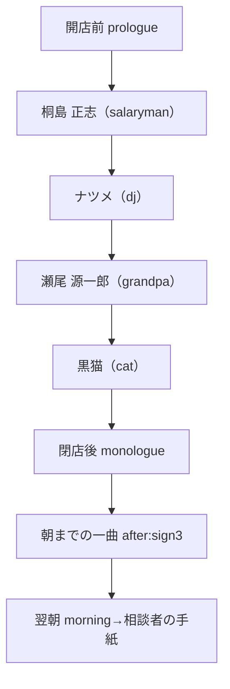
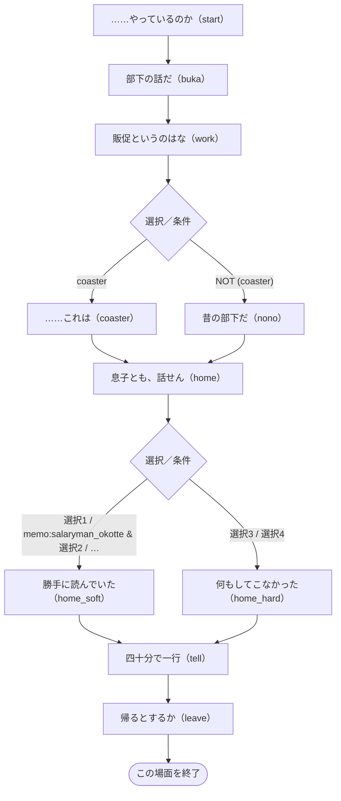
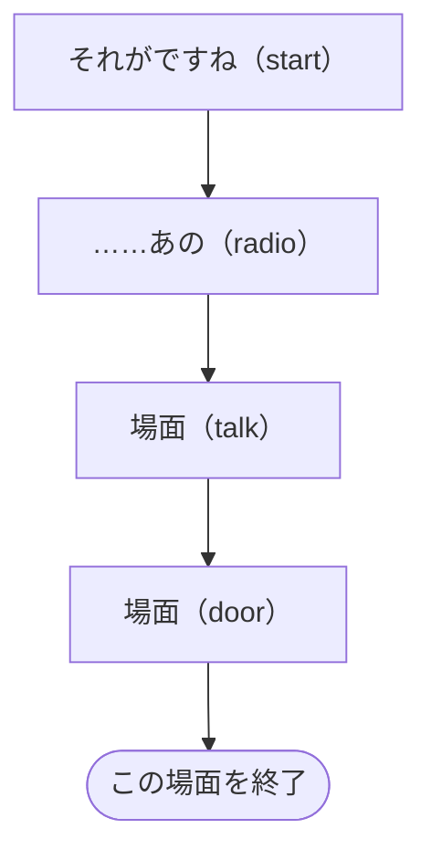
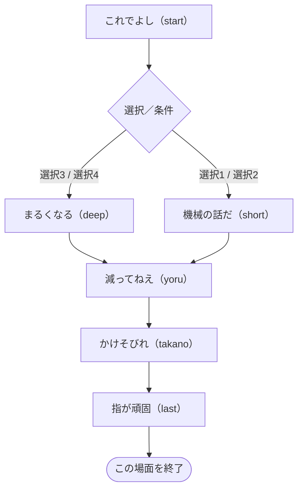

# 第三夜 — 雨の音と、欠けた取っ手

> 自動生成：`node tools/generate-branchmaps.js`。実装の動作を記述。ネタバレを含みます。

[[../00_全体マップ|全体へ]] · [[../10_ルートとED|判定の詳細]]

## この夜の進行

根拠：[story/frame3.js](../../../story/frame3.js) · `nights.3` の `order / after / prologue / monologue / morning`。

**朝の処理が仕事を確定**：`kiri_ask` があれば `morning` の名刺受け渡しで `kiri_job` が立ちます。独白・after と朝の間で状態が違います。

## 場面ごとの分岐

ノードは短い場面の言葉とコード内のラベル名です。図の選択番号は該当choice/acts内の1始まり、表の先頭番号はscript全体でのカード群の通し番号（acts含む）です。ソース内位置で照合できます。同じ移動先は合流させています。表示条件の「制限なし」は、そのラベル・外側の条件を通ってカード群が実行されている場合を指します。状態を変える選択は表を優先して確認してください。全条件の正確な配列位置は [[../details/条件索引|条件索引]] と `data/branch-model.json` にあります。

### 後の展開への影響

`kiri_job` は仕事とT4へ、`kiri_ask` は翌朝の名刺受け渡しへつながります。`grandpa_call` は第四夜の澄江の戸口や鉢合わせの描写で参照され、澄江の第五夜の相談自体をスキップする条件ではありません。 根拠と参照先は [[../20_フラグ依存関係|フラグ依存関係]]・[[../details/条件索引|全参照索引]] にあります。

### 桐島 正志（salaryman）

[story/salaryman.js](../../../story/salaryman.js) · `visitors.salaryman.script`。

| 選択群-カード・短い文言 | 表示条件 | 状態変化 | 移動 | ソース内位置 |
| --- | --- | --- | --- | --- |
| 5-1 坂の下のコンビニの、夜勤の方です | 制限なし | kiri_job ON | 反応後に続行／合流 | `coaster.25.choice.0` |
| 5-2 ご本人に聞いてから、お伝えします | 制限なし | kiri_ask ON | 反応後に続行／合流 | `coaster.25.choice.1` |
| 5-3 お客さんの忘れものなので | 制限なし | 採点なし・直接の状態変更なし | 反応後に続行／合流 | `coaster.25.choice.2` |
| 6-1 ドア越しの、おやすみ、なら、誤字の直しようもないですね | 制限なし | 距離:just | `home_soft` | `home.17.choice.0` |
| 6-2 怒ってるみたいなおやすみでも、ドア越しなら、ちゃんと… | `memo:salaryman_okotte` | 距離:just | `home_soft` | `home.17.choice.1` |
| 6-3 息子さんも、本当はお父さんと話したいんだと思いますよ | 制限なし | 距離:near | `home_hard` | `home.17.choice.2` |
| 6-4 中学二年なら、そっとしておくのがいちばんですよ | 制限なし | 距離:far | `home_hard` | `home.17.choice.3` |
| 6-5 桐島さんが中学生のころ、お父さんとは話しましたか | 制限なし | 距離:odd | `home_soft` | `home.17.choice.4` |
| 8-1 上手な言い方を待つより、言ったかどうかのほうが、残る… | 制限なし | salary_tell ON / 距離:just | 反応後に続行／合流 | `tell.10.choice.0` |
| 8-2 四十分ぶん消した文のなかに、消さなくてよかった一文は… | `memo:salaryman_yonjuppun` | salary_tell ON / 距離:just | 反応後に続行／合流 | `tell.10.choice.1` |
| 8-3 言葉にしなくても、桐島さんのお気持ちは、きっと伝わっ… | 制限なし | 距離:near | 反応後に続行／合流 | `tell.10.choice.2` |
| 8-4 言葉が硬いのは性分ですから、無理に変えなくてもいいの… | 制限なし | 距離:far | 反応後に続行／合流 | `tell.10.choice.3` |
| 8-5 （メモ用紙とペンを差し出して）今ここで、一行、練習し… | 制限なし | 距離:odd m-1 good:false | 反応後に続行／合流 | `tell.10.choice.4` |

簡略化：acts 2群（採点なし）、直接の状態・移動指定がない通常カード 3群（相談者なら距離・結果には影響）。共通の採点式は [[../10_ルートとED#相談結果 good / mid / bad|相談結果]]。

参照する状態・条件：`konbini_words`、`good:ol`、`mid:ol`、`ol_words`、`route:nanami`、`coaster`、`salary_tell`、`ok:ol`。会話差分も含み、すべてが移動分岐になるわけではありません。

### ナツメ（dj）

[story/frame3.js](../../../story/frame3.js) · `nights.3.dj.script`。

| 選択群-カード・短い文言 | 表示条件 | 状態変化 | 移動 | ソース内位置 |
| --- | --- | --- | --- | --- |
| 1-1 （黙って受け取り、棚の、自分のマグの隣に並べる） | 制限なし | dj +2 | 反応後に続行／合流 | `start.42.choice.0` |
| 1-2 取っ手、欠けたまま使ってるんですね | 制限なし | dj +1 | 反応後に続行／合流 | `start.42.choice.1` |
| 1-3 これでもう、ここはナツメさんの店でもありますね | 制限なし | dj +0 | 反応後に続行／合流 | `start.42.choice.2` |
| 1-4 お店のカップで、よかったのに | 制限なし | dj -1 | 反応後に続行／合流 | `start.42.choice.3` |
| 2-1 （黙って、氷をひとつ、豆皿にのせて添える） | 制限なし | dj +2 | 反応後に続行／合流 | `radio.3.then.1.choice.0` |
| 2-2 あれは、わたしへのメッセージですよね | 制限なし | dj +0 | 反応後に続行／合流 | `radio.3.then.1.choice.1` |
| 2-3 すみません、仕込みをしていて、ちゃんとは | 制限なし | dj -1 | 反応後に続行／合流 | `radio.3.then.1.choice.2` |
| 2-4 ふたつだと、薄くなりますからね | 制限なし | dj +1 | 反応後に続行／合流 | `radio.3.then.1.choice.3` |
| 3-1 （小さく、続きを口ずさむ）朝が来るまで、となりの木馬で | 制限なし | dj +2 | 反応後に続行／合流 | `radio.3.else.0.then.1.choice.0` |
| 3-2 あれは、わたしに向けて、ですよね | 制限なし | dj +0 | 反応後に続行／合流 | `radio.3.else.0.then.1.choice.1` |
| 3-3 すみません、仕込みをしていて、ちゃんとは | 制限なし | dj -1 | 反応後に続行／合流 | `radio.3.else.0.then.1.choice.2` |
| 3-4 曲は、かけてくれないんですね | 制限なし | dj +1 | 反応後に続行／合流 | `radio.3.else.0.then.1.choice.3` |
| 4-1 ちょうどいい温度、でしたね | 制限なし | dj +2 | 反応後に続行／合流 | `radio.3.else.0.else.1.choice.0` |
| 4-2 あれは、この店のこと、ですよね | 制限なし | dj +0 | 反応後に続行／合流 | `radio.3.else.0.else.1.choice.1` |
| 4-3 すみません、仕込みをしていて、ちゃんとは | 制限なし | dj -1 | 反応後に続行／合流 | `radio.3.else.0.else.1.choice.2` |
| 4-4 傘は、忘れずに、とも言ってましたね | 制限なし | dj +1 | 反応後に続行／合流 | `radio.3.else.0.else.1.choice.3` |
| 5-1 （勝手口の脇から黒い傘を取ってきて、柄のほうを差し出… | 制限なし | dj_umbrella ON / dj +2 | `door` | `talk.27.choice.0` |
| 5-2 坂の下まで、いっしょに行きましょう | 制限なし | dj_umbrella, dj_walk ON / dj +1 | `door` | `talk.27.choice.1` |
| 5-3 雨がやむまで、ここにいてください。朝まででも | 制限なし | dj +0 | `door` | `talk.27.choice.2` |
| 5-4 タクシー、呼びましょうか | 制限なし | dj -1 | `door` | `talk.27.choice.3` |

簡略化：acts 0群（採点なし）、直接の状態・移動指定がない通常カード 1群（相談者なら距離・結果には影響）。共通の採点式は [[../10_ルートとED#相談結果 good / mid / bad|相談結果]]。

参照する状態・条件：`dj_mug`、`dj_ice`、`dj_song`、`djroute`、`dj_walk`、`dj_umbrella`。会話差分も含み、すべてが移動分岐になるわけではありません。

### 瀬尾 源一郎（grandpa）

[story/grandpa.js](../../../story/grandpa.js) · `visitors.grandpa.script`。

| 選択群-カード・短い文言 | 表示条件 | 状態変化 | 移動 | ソース内位置 |
| --- | --- | --- | --- | --- |
| 3-1 奥さまのこと、たくさん聞かせてください。泣いてもいい… | 制限なし | 距離:near | `short` | `start.90.choice.0` |
| 3-2 時間が経てば、少しずつ慣れていくものなんでしょうね | 制限なし | 距離:far | `short` | `start.90.choice.1` |
| 3-3 炊飯器のほうは、まだ千鶴さんの分を覚えているんですね | 制限なし | 距離:just | `deep` | `start.90.choice.2` |
| 3-4 （黙って、おにぎりの包みの横に、小皿とお手拭きを置く） | 制限なし | 距離:odd | `deep` | `start.90.choice.3` |
| 7-1 澄江さんは、千鶴さんの話ができる相手でもあるんですね | 制限なし | grandpa_call ON / 距離:just | 反応後に続行／合流 | `takano.17.choice.0` |
| 7-2 ここの電話、使ってください。いま、かけましょう | 制限なし | 距離:near | 反応後に続行／合流 | `takano.17.choice.1` |
| 7-3 知らせないほうが、相手のためということもありますよ | 制限なし | 距離:far | 反応後に続行／合流 | `takano.17.choice.2` |
| 7-4 （棚の、花の入っていない一輪挿しに目をやる） | 制限なし | grandpa_call ON / 距離:odd | 反応後に続行／合流 | `takano.17.choice.3` |
| 8-1 ひとつ、いただいてもいいですか。ちょうど、お腹がすい… | 制限なし | grandpa_one ON / 距離:just | 反応後に続行／合流 | `last.5.choice.0` |
| 8-2 邪道でおいしいなら、よその店で一緒に食べても、いいの… | `memo:grandpa_jadou` | grandpa_one ON / 距離:just | 反応後に続行／合流 | `last.5.choice.1` |
| 8-3 炊飯器、一合炊きの小さいのに買い替えてみては | 制限なし | 距離:far | 反応後に続行／合流 | `last.5.choice.2` |
| 8-4 毎晩来てください！　おにぎり、わたしが全部いただきます | 制限なし | 距離:near | 反応後に続行／合流 | `last.5.choice.3` |
| 8-5 その指が覚えているうちは、二合のままでいい気がします | 制限なし | 距離:odd | 反応後に続行／合流 | `last.5.choice.4` |

簡略化：acts 2群（採点なし）、直接の状態・移動指定がない通常カード 3群（相談者なら距離・結果には影響）。共通の採点式は [[../10_ルートとED#相談結果 good / mid / bad|相談結果]]。

参照する状態・条件：`djroute`、`cat>=1`。会話差分も含み、すべてが移動分岐になるわけではありません。

### 黒猫（cat）

[story/frame3.js](../../../story/frame3.js) · `nights.3.cat.script`。

`start` → 場面終了。途中のカードは反応後に同じ流れへ合流します。

| 選択群-カード・短い文言 | 表示条件 | 状態変化 | 移動 | ソース内位置 |
| --- | --- | --- | --- | --- |
| 1-1 窓が開いているうちは、急がなくていいのかもしれない | 制限なし | cat +1 | 反応後に続行／合流 | `start.47.choice.0` |
| 1-2 今夜の人、きみを待ってたよ。帰ってあげたら | 制限なし | cat +0 | 反応後に続行／合流 | `start.47.choice.1` |
| 1-3 猫なんだから、好きなところで暮らせばいいよ | 制限なし | cat -1 | 反応後に続行／合流 | `start.47.choice.2` |
| 1-4 （竹の皮の切れ端を、黙って猫の前に置く） | 制限なし | cat +1 | 反応後に続行／合流 | `start.47.choice.3` |

参照する状態・条件：`grandpa_one`。会話差分も含み、すべてが移動分岐になるわけではありません。

### 朝までの一曲

[story/frame3.js](../../../story/frame3.js) · `nights.3.scenes.sign3.script`。

`start` → 場面終了。途中のカードは反応後に同じ流れへ合流します。

簡略化：acts 0群（採点なし）、直接の状態・移動指定がない通常カード 1群（相談者なら距離・結果には影響）。共通の採点式は [[../10_ルートとED#相談結果 good / mid / bad|相談結果]]。

参照する状態・条件：`dj_walk2_star`、`dj_walk2_lemon`、`!dj_walk2_star & !dj_walk2_lemon`、`dj_umbrella`。会話差分も含み、すべてが移動分岐になるわけではありません。

## 開店前・独白・翌朝の状態参照

| 場面 | 条件 | ソース内位置 |
| --- | --- | --- |
| prologue | `route:nanami` | `STORY.nights.3.prologue.7` |
| prologue | `route:haruka` | `STORY.nights.3.prologue.8` |
| prologue | `djroute` | `STORY.nights.3.prologue.9` |
| prologue | `route:alone & !djroute` | `STORY.nights.3.prologue.10` |
| prologue | `coaster` | `STORY.nights.3.prologue.15` |
| prologue | `dj_ice` | `STORY.nights.3.prologue.21` |
| prologue | `dj_song` | `STORY.nights.3.prologue.21.else.0` |
| monologue | `salary_tell` | `STORY.nights.3.monologue.5` |
| monologue | `kiri_ask` | `STORY.nights.3.monologue.6` |
| monologue | `kiri_job` | `STORY.nights.3.monologue.7` |
| monologue | `dj_umbrella` | `STORY.nights.3.monologue.14` |
| monologue | `djroute` | `STORY.nights.3.monologue.16` |
| monologue | `djroute` | `STORY.nights.3.monologue.18` |
| morning | `kiri_ask` | `STORY.nights.3.morning.0` |
| morning | `dj_umbrella` | `STORY.nights.3.morning.5` |
| morning | `kiri_ask` | `STORY.nights.3.morning.11` |

