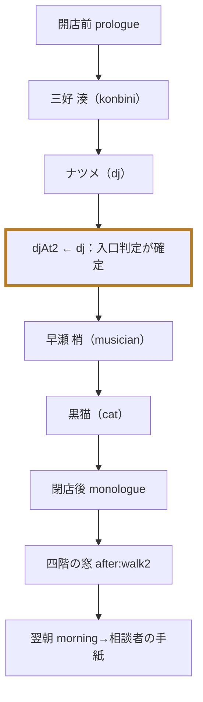
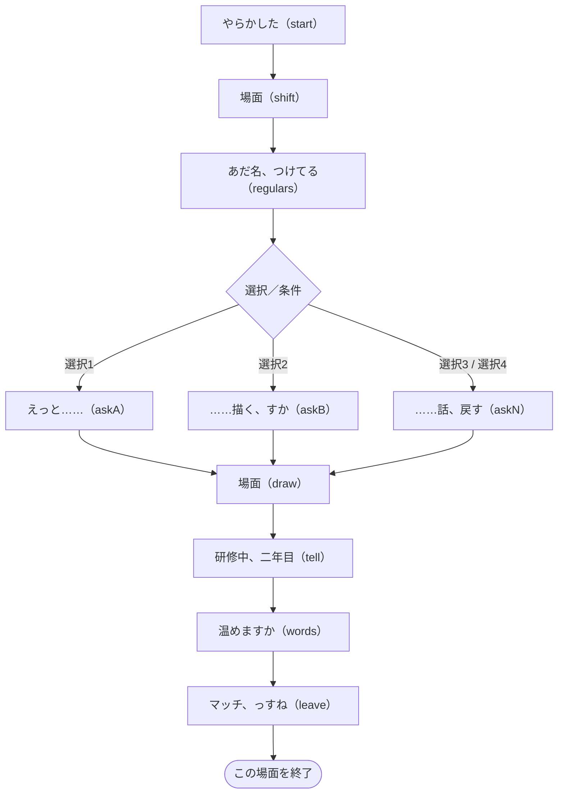
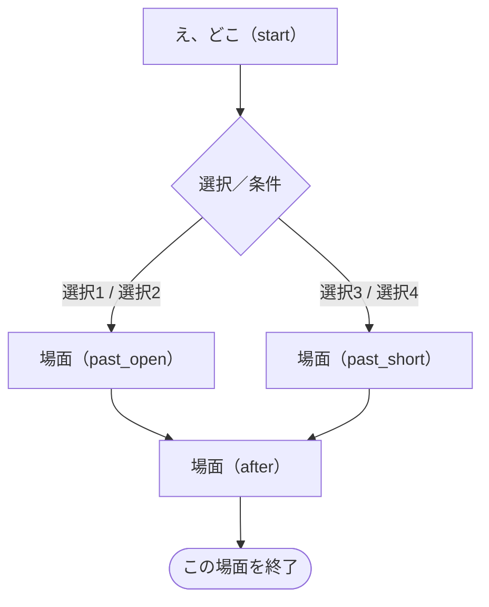
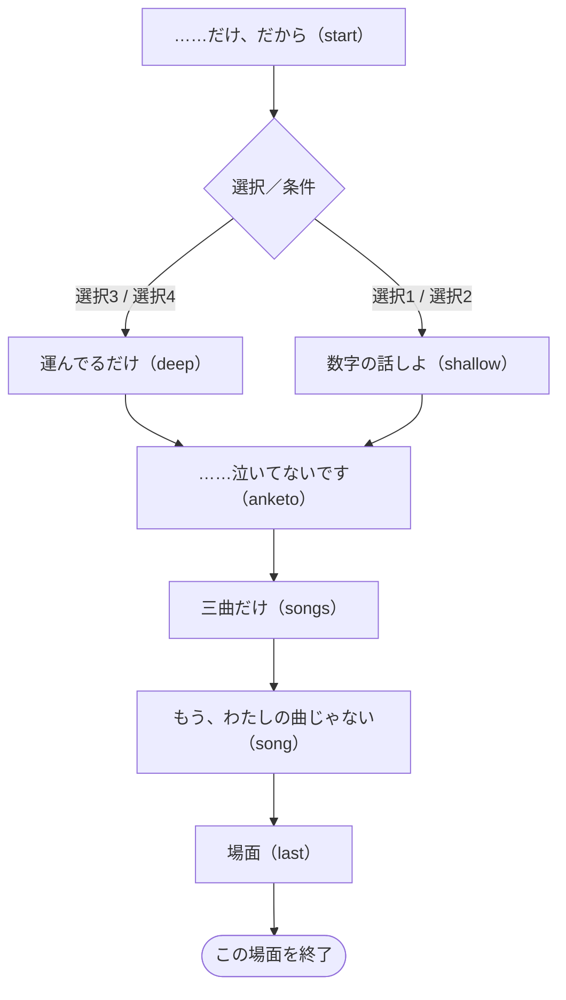

# 第二夜 — 風の夜と、取り違えたマグ

> 自動生成：`node tools/generate-branchmaps.js`。実装の動作を記述。ネタバレを含みます。

[[../00_全体マップ|全体へ]] · [[../10_ルートとED|判定の詳細]]

## この夜の進行

根拠：[story/frame2.js](../../../story/frame2.js) · `nights.2` の `order / after / prologue / monologue / morning`。

**確定タイミングに注意**：湊の結果が出た後でも、`djAt2` はまだ null。ナツメ終了時に累積 `dj` を保存し、その後の `route()`／`djRoute()` はその保存値を使います。後の dj 増減は入口を変えません。

## 場面ごとの分岐

ノードは短い場面の言葉とコード内のラベル名です。図の選択番号は該当choice/acts内の1始まり、表の先頭番号はscript全体でのカード群の通し番号（acts含む）です。ソース内位置で照合できます。同じ移動先は合流させています。表示条件の「制限なし」は、そのラベル・外側の条件を通ってカード群が実行されている場合を指します。状態を変える選択は表を優先して確認してください。全条件の正確な配列位置は [[../details/条件索引|条件索引]] と `data/branch-model.json` にあります。

### 後の展開への影響

`mi_tell / mi_rush / konbini_words` は三好の人生の優先判定へ、`coaster` は第三夜の桐島の仕事の話へつながります。梢の`musician_song`は以後の歌の差分で参照されます。 根拠と参照先は [[../20_フラグ依存関係|フラグ依存関係]]・[[../details/条件索引|全参照索引]] にあります。

### 三好 湊（konbini）

[story/konbini.js](../../../story/konbini.js) · `visitors.konbini.script`。

| 選択群-カード・短い文言 | 表示条件 | 状態変化 | 移動 | ソース内位置 |
| --- | --- | --- | --- | --- |
| 2-1 引き受ける前に、明日お返事します、をひとつ挟んでみる… | 制限なし | mi_no ON / 距離:just | 反応後に続行／合流 | `shift.5.choice.0` |
| 2-2 それはひどい。店長さんに、はっきり無理だと言うべきです | 制限なし | 距離:near | 反応後に続行／合流 | `shift.5.choice.1` |
| 2-3 人手不足なら、しばらくは仕方ないのかもしれませんね | 制限なし | 距離:far | 反応後に続行／合流 | `shift.5.choice.2` |
| 2-4 （眠れていますか、とは聞かずに、ホットミルクを小鍋に… | 制限なし | 距離:odd | 反応後に続行／合流 | `shift.5.choice.3` |
| 4-1 どんな人です？ | 制限なし | draw_a ON / 距離:just | `askA` | `regulars.32.choice.0` |
| 4-2 描いてみてもらえます？ | 制限なし | coaster ON / 距離:odd | `askB` | `regulars.32.choice.1` |
| 4-3 それはもう、恋ですね。好きなんでしょう、その人のこと | 制限なし | 距離:near | `askN` | `regulars.32.choice.2` |
| 4-4 お客さんに特別な気持ちを持つのは、なかなか難しいですね | 制限なし | 距離:far | `askN` | `regulars.32.choice.3` |
| 5-1 疲れた顔と、笑う顔のあいだ。言葉より、ずっと届きました | 制限なし | mi_draw ON / 距離:just | 反応後に続行／合流 | `draw.2.then.2.choice.0` |
| 5-2 すごく上手です。絵のお仕事だって、きっとできますよ | 制限なし | 距離:near | 反応後に続行／合流 | `draw.2.then.2.choice.1` |
| 5-3 絵が描けるのは、いい趣味ですね | 制限なし | 距離:far | 反応後に続行／合流 | `draw.2.then.2.choice.2` |
| 5-4 （伏せたコースターを、そっと表に返す） | 制限なし | 距離:odd m-2 good:false | 反応後に続行／合流 | `draw.2.then.2.choice.3` |
| 6-1 六冊の中から一枚だけ、誰か一人に見せてみるのは | 制限なし | mi_draw ON / 距離:just | 反応後に続行／合流 | `draw.2.else.0.then.7.choice.0` |
| 6-2 ぜひ見たいです。今度、ここに持ってきてください | 制限なし | 距離:near | 反応後に続行／合流 | `draw.2.else.0.then.7.choice.1` |
| 6-3 見せないと決めているなら、それでいいと思います | 制限なし | 距離:far | 反応後に続行／合流 | `draw.2.else.0.then.7.choice.2` |
| 6-4 （伝票の束から一枚抜いて、白い裏を上にして置く） | 制限なし | 距離:odd | 反応後に続行／合流 | `draw.2.else.0.then.7.choice.3` |
| 7-1 手がおぼえているなら、捨てたことには、ならないのかも… | 制限なし | mi_draw ON / 距離:just | 反応後に続行／合流 | `draw.2.else.0.else.7.choice.0` |
| 7-2 もったいない。また描きましょう、今からでも遅くないです | 制限なし | 距離:near | 反応後に続行／合流 | `draw.2.else.0.else.7.choice.1` |
| 7-3 やめると決めたなら、それもひとつの答えですね | 制限なし | 距離:far | 反応後に続行／合流 | `draw.2.else.0.else.7.choice.2` |
| 7-4 （伝票用の鉛筆を、彼の手の届くところに置く） | 制限なし | 距離:odd | 反応後に続行／合流 | `draw.2.else.0.else.7.choice.3` |
| 8-1 言うか言わないか、いつ言うかも、三好さんが自分で決め… | 制限なし | mi_tell ON / 距離:just | `words` | `tell.30.choice.0` |
| 8-2 研修中のシールと同じで、はがす日も、三好さんが決めて… | `memo:konbini_seal` | mi_tell ON / 距離:just | `words` | `tell.30.choice.1` |
| 8-3 今夜のうちに決めましょう。言わないと、絶対に後悔しま… | 制限なし | mi_rush ON / 距離:near | `words` | `tell.30.choice.2` |
| 8-4 片思いのままでいるほうが、きれいに残ることもありますね | 制限なし | 距離:far | `words` | `tell.30.choice.3` |
| 8-5 （ふっと笑って、杏仁豆腐ならうちでも出せますよ、と冗… | 制限なし | 距離:odd m+2 good:false | `words` | `tell.30.choice.4` |
| 9-1 温めますか、のあとに、ひとことだけ。今夜のシフトで、… | 制限なし | konbini_words ON / 距離:just | `leave` | `words.17.choice.0` |
| 9-2 部屋で言ってみる、あ、の声。あれを、レンジの前で一回… | `memo:konbini_koe` | konbini_words ON / 距離:just | `leave` | `words.17.choice.1` |
| 9-3 明日から、お客さん全員に話しかけてみましょう。きっと… | 制限なし | 距離:near | `leave` | `words.17.choice.2` |
| 9-4 決まった言葉だけでも、ちゃんとお仕事になっていますよ | 制限なし | 距離:far | `leave` | `words.17.choice.3` |
| 9-5 （温めますか、と訊いて、彼のカップに手をのばす） | 制限なし | konbini_words ON / 距離:odd | `leave` | `words.17.choice.4` |

簡略化：acts 2群（採点なし）、直接の状態・移動指定がない通常カード 0群（相談者なら距離・結果には影響）。共通の採点式は [[../10_ルートとED#相談結果 good / mid / bad|相談結果]]。

参照する状態・条件：`good:student`、`hi_no`、`hi_song`、`ok:ol`、`coaster`、`hi_draw`、`draw_a`、`mi_tell`、`mi_rush`、`konbini_words`、`mi_no`。会話差分も含み、すべてが移動分岐になるわけではありません。

### ナツメ（dj）

[story/frame2.js](../../../story/frame2.js) · `nights.2.dj.script`。

| 選択群-カード・短い文言 | 表示条件 | 状態変化 | 移動 | ソース内位置 |
| --- | --- | --- | --- | --- |
| 1-1 ちょうどいい温度だったなら、よかったです | 制限なし | dj_mug ON / dj +2 | 反応後に続行／合流 | `start.50.choice.0` |
| 1-2 気にしないで。……間接、とか、気にしないので | 制限なし | dj +0 | 反応後に続行／合流 | `start.50.choice.1` |
| 1-3 （黙って受け取り、新しいマグと取り替える） | 制限なし | dj -1 | 反応後に続行／合流 | `start.50.choice.2` |
| 1-4 （黙って、そのマグを彼女のほうへ押しやる） | 制限なし | dj +1 | 反応後に続行／合流 | `start.50.choice.3` |
| 2-1 昔、眠れなかったころに、一度だけこの店に救われたんです | 制限なし | dj +2 | `past_open` | `start.65.choice.0` |
| 2-2 （少し考えて、窓の外の上弦の月を見る） | 制限なし | dj +1 | `past_open` | `start.65.choice.1` |
| 2-3 ナツメさんに会えるから、かな | 制限なし | dj +0 | `past_short` | `start.65.choice.2` |
| 2-4 大家さんの貼り紙を見て、なんとなく、です | 制限なし | dj -1 | `past_short` | `start.65.choice.3` |
| 3-1 正直、あまり。でも、ここにいる夜は悪くないです | 制限なし | dj +2 | 反応後に続行／合流 | `after.15.choice.0` |
| 3-2 ナツメさんが毎晩来てくれたら、眠れるかも | 制限なし | dj +0 | 反応後に続行／合流 | `after.15.choice.1` |
| 3-3 大丈夫です。慣れてるので | 制限なし | dj -1 | 反応後に続行／合流 | `after.15.choice.2` |
| 3-4 （唇に人さし指を立てて、内緒、という顔をする） | 制限なし | dj +2 | 反応後に続行／合流 | `after.15.choice.3` |

参照する状態・条件：`dj_song`、`dj_ice`、`konbini_words`、`dj_mug`。会話差分も含み、すべてが移動分岐になるわけではありません。

### 早瀬 梢（musician）

[story/musician.js](../../../story/musician.js) · `visitors.musician.script`。

| 選択群-カード・短い文言 | 表示条件 | 状態変化 | 移動 | ソース内位置 |
| --- | --- | --- | --- | --- |
| 2-1 やめちゃだめですよ。憧れて入ったバンドなんですから | 制限なし | 距離:near | `shallow` | `start.40.choice.0` |
| 2-2 大学二年なら、そろそろ将来のことも考える時期ですよね | 制限なし | 距離:far | `shallow` | `start.40.choice.1` |
| 2-3 叶ってるのに、の続きが、たぶん本題ですね | 制限なし | 距離:just | `deep` | `start.40.choice.2` |
| 2-4 （黙って、ほうじ茶のペットボトルをお湯で温めはじめる） | 制限なし | kozue_tea ON / 距離:odd | `deep` | `start.40.choice.3` |
| 5-1 自分の曲は、もっと実力がついてからでも遅くないですよ | 制限なし | 距離:far | 反応後に続行／合流 | `songs.11.choice.0` |
| 5-2 浮くと言われた声で書いた三曲なら、浮いたままで、ちょ… | `memo:musician_uku` | 距離:just | 反応後に続行／合流 | `songs.11.choice.1` |
| 5-3 今ここで、一曲だけでも聴かせてもらえませんか | 制限なし | 距離:near | 反応後に続行／合流 | `songs.11.choice.2` |
| 5-4 三曲とも、まだ梢さんの部屋の中でだけ鳴ってるんですね | 制限なし | 距離:just | 反応後に続行／合流 | `songs.11.choice.3` |
| 5-5 （何も言わずに、窓の風がひと息やむのを待つ） | 制限なし | 距離:odd | 反応後に続行／合流 | `songs.11.choice.4` |
| 7-1 サキさんの曲はもう卒業して、自分の曲で勝負しましょう | 制限なし | 距離:near m-2 | 反応後に続行／合流 | `song.11.choice.0` |
| 7-2 梢さんの声で歌う午前二時は、まだ誰も聴いたことがない… | 制限なし | musician_song ON / 距離:just | 反応後に続行／合流 | `song.11.choice.1` |
| 7-3 空気入れの隣で鳴る午前二時は、どんな音がするんでしょ… | `memo:musician_kuuki` | musician_song ON / 距離:just | 反応後に続行／合流 | `song.11.choice.2` |
| 7-4 お客さんが望むなら、サキさんに寄せて歌うのも誠実さで… | 制限なし | 距離:far | 反応後に続行／合流 | `song.11.choice.3` |
| 7-5 一節だけ、今夜の梢さんの歌い方で、歌ってもらえますか | 制限なし | musician_song ON / 距離:odd | 反応後に続行／合流 | `song.11.choice.4` |

簡略化：acts 2群（採点なし）、直接の状態・移動指定がない通常カード 3群（相談者なら距離・結果には影響）。共通の採点式は [[../10_ルートとED#相談結果 good / mid / bad|相談結果]]。

参照する状態・条件：`djroute`、`konbini_words`、`hi_song`、`kozue_tea`、`musician_song`。会話差分も含み、すべてが移動分岐になるわけではありません。

### 黒猫（cat）

[story/frame2.js](../../../story/frame2.js) · `nights.2.cat.script`。

`start` → 場面終了。途中のカードは反応後に同じ流れへ合流します。

| 選択群-カード・短い文言 | 表示条件 | 状態変化 | 移動 | ソース内位置 |
| --- | --- | --- | --- | --- |
| 1-1 待つって、帰る場所を温めておくことかもしれない | 制限なし | cat +1 | 反応後に続行／合流 | `start.17.choice.0` |
| 1-2 待たなくていいよ。ここに、ずっといればいい | 制限なし | cat +0 | 反応後に続行／合流 | `start.17.choice.1` |
| 1-3 待っても、来ない人は来ないよ | 制限なし | cat -1 | 反応後に続行／合流 | `start.17.choice.2` |
| 1-4 （隣に座って、いっしょに黙って窓の外を見る） | 制限なし | cat +1 | 反応後に続行／合流 | `start.17.choice.3` |

### 四階の窓

[story/frame2.js](../../../story/frame2.js) · `nights.2.scenes.walk2.script`。

`start` → 場面終了。途中のカードは反応後に同じ流れへ合流します。

| 選択群-カード・短い文言 | 表示条件 | 状態変化 | 移動 | ソース内位置 |
| --- | --- | --- | --- | --- |
| 1-1 （少し考えて）森園かおるの、星をひろう人 | 制限なし | dj_walk2_star ON | 反応後に続行／合流 | `start.37.choice.0` |
| 1-2 （少し考えて）沢渡ユキの、レモン色のカーテン | 制限なし | dj_walk2_lemon ON | 反応後に続行／合流 | `start.37.choice.1` |
| 1-3 （少し考えて、思いつかない、と首を振る） | 制限なし | 採点なし・直接の状態変更なし | 反応後に続行／合流 | `start.37.choice.2` |

## 開店前・独白・翌朝の状態参照

| 場面 | 条件 | ソース内位置 |
| --- | --- | --- |
| prologue | `ok:ol` | `STORY.nights.2.prologue.8` |
| prologue | `dj_song` | `STORY.nights.2.prologue.14` |
| prologue | `dj_ice` | `STORY.nights.2.prologue.14.else.0` |
| monologue | `ok:konbini` | `STORY.nights.2.monologue.4` |
| monologue | `musician_song` | `STORY.nights.2.monologue.6` |
| monologue | `djroute` | `STORY.nights.2.monologue.7` |
| monologue | `dj_mug` | `STORY.nights.2.monologue.12` |
| morning | `coaster` | `STORY.nights.2.morning.0` |

