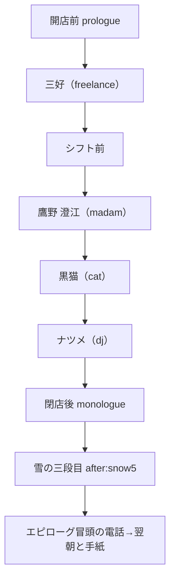
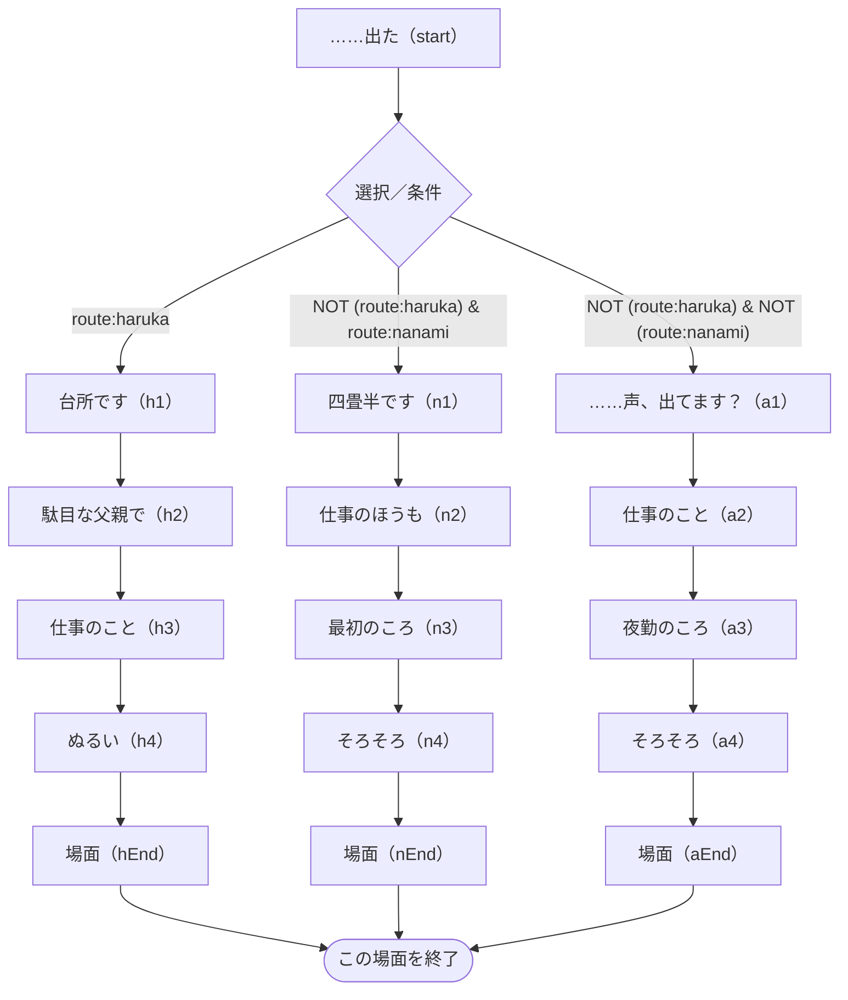
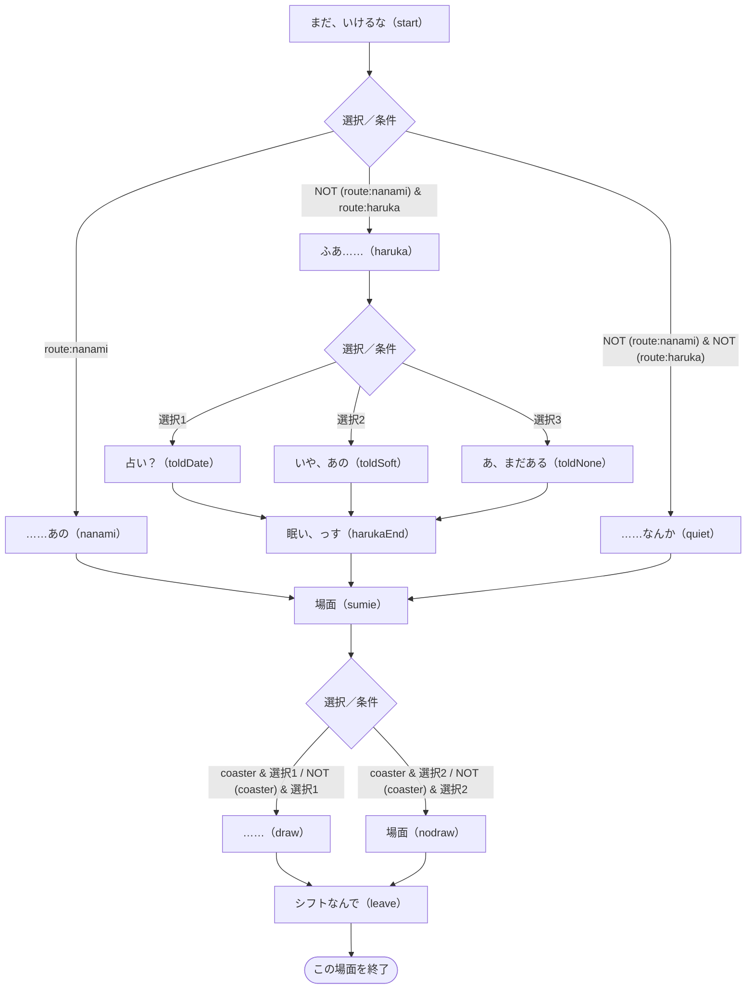
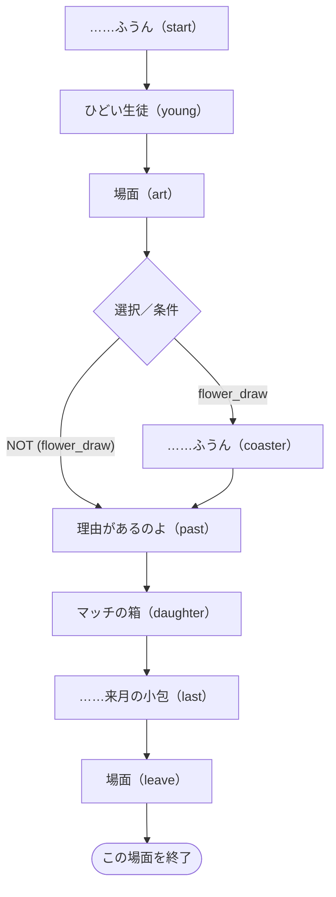
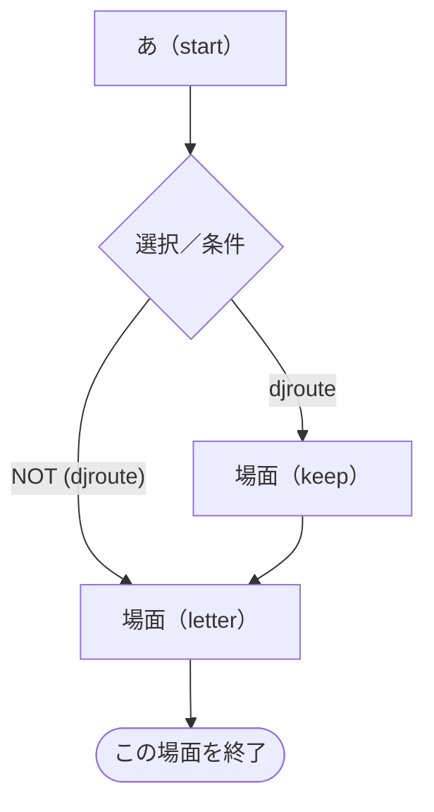

# 第五夜 — 初雪と、一輪の寒椿

> 自動生成：`node tools/generate-branchmaps.js`。実装の動作を記述。ネタバレを含みます。

[[../00_全体マップ|全体へ]] · [[../10_ルートとED|判定の詳細]]

## この夜の進行

根拠：[story/frame5.js](../../../story/frame5.js) · `nights.5` の `order / after / prologue / monologue / morning`。

## 場面ごとの分岐

ノードは短い場面の言葉とコード内のラベル名です。図の選択番号は該当choice/acts内の1始まり、表の先頭番号はscript全体でのカード群の通し番号（acts含む）です。ソース内位置で照合できます。同じ移動先は合流させています。表示条件の「制限なし」は、そのラベル・外側の条件を通ってカード群が実行されている場合を指します。状態を変える選択は表を優先して確認してください。全条件の正確な配列位置は [[../details/条件索引|条件索引]] と `data/branch-model.json` にあります。

### 後の展開への影響

`flower_draw` は澄江が絵を受け取る`sumie_coaster`へ、`told_date / told_soft` は人生エピローグの回想へつながります。`keep_light` はナツメルートの全カードでONになり、継続の回想に使われます。Eの判定はdjrouteと最終djです。 根拠と参照先は [[../20_フラグ依存関係|フラグ依存関係]]・[[../details/条件索引|全参照索引]] にあります。

### 三好（freelance）

[story/freelance.js](../../../story/freelance.js) · `visitors.freelance.script`。

| 選択群-カード・短い文言 | 表示条件 | 状態変化 | 移動 | ソース内位置 |
| --- | --- | --- | --- | --- |
| 4-1 駄目な父親なんかじゃありません。そんなふうに思わないで | 制限なし | 距離:near | 反応後に続行／合流 | `h2.12.choice.0` |
| 4-2 駄目だ、って言える相手が、今夜はここだったんですね | 制限なし | 距離:just | 反応後に続行／合流 | `h2.12.choice.1` |
| 4-3 これからは、夜は電話に出られるようにすれば、いいんで… | 制限なし | 距離:far | 反応後に続行／合流 | `h2.12.choice.2` |
| 4-4 くまのぬいぐるみを抱えて扉を開けたところ、見ていない… | `memo:freelance_kuma` | 距離:just | 反応後に続行／合流 | `h2.12.choice.3` |
| 4-5 ひよりちゃんは、きっともう、パパを許していますよ | 制限なし | 距離:odd m-2 good:false | 反応後に続行／合流 | `h2.12.choice.4` |
| 5-1 お仕事なら、どうしても仕方のないことも、ありますよね | 制限なし | 距離:far | 反応後に続行／合流 | `h3.11.choice.0` |
| 5-2 仕事なんて全部断って、学芸会には必ず行くべきですよ | 制限なし | 距離:near | 反応後に続行／合流 | `h3.11.choice.1` |
| 5-3 お月さまのセリフ、ひよりちゃん、なんて言うんでしょうね | 制限なし | freelance_no ON / 距離:just | 反応後に続行／合流 | `h3.11.choice.2` |
| 5-4 （耳をすまして）その時計、学芸会の日も、ちゃんと動い… | 制限なし | 距離:odd | 反応後に続行／合流 | `h3.11.choice.3` |
| 10-1 今夜は、待ってみてもいいのかもしれませんね。一晩だけ… | 制限なし | freelance_no ON / 距離:just | 反応後に続行／合流 | `n3.10.choice.0` |
| 10-2 奥さんのほうから歩み寄ってくれるのを、待つのはどうで… | 制限なし | 距離:far | 反応後に続行／合流 | `n3.10.choice.1` |
| 10-3 仕事をしばらく減らして、奥さんとの時間を最優先にしま… | 制限なし | 距離:near | 反応後に続行／合流 | `n3.10.choice.2` |
| 10-4 そのときの、ひとことは、何て言ったんですか | 制限なし | 距離:odd | 反応後に続行／合流 | `n3.10.choice.3` |
| 11-1 なんにも起きていない夜の話、聞けてよかったです | 制限なし | 距離:just | 反応後に続行／合流 | `n4.12.choice.0` |
| 11-2 また何かあったら、いつでもかけてきてください | 制限なし | 距離:near | 反応後に続行／合流 | `n4.12.choice.1` |
| 11-3 もう遅いので、今夜は休んでくださいね | 制限なし | 距離:far | 反応後に続行／合流 | `n4.12.choice.2` |
| 11-4 給水塔の見えるお部屋で、なんにも起きない夜。いい眺め… | `memo:freelance_tower` | 距離:just | 反応後に続行／合流 | `n4.12.choice.3` |
| 11-5 （ふすまの向こうの寝息が聞こえないか、黙って耳をすま… | 制限なし | 距離:odd | 反応後に続行／合流 | `n4.12.choice.4` |
| 14-1 明日、仕事をひとつ、断ってみる練習から、というのは | 制限なし | freelance_no ON / 距離:just | 反応後に続行／合流 | `a3.11.choice.0` |
| 14-2 寂しいなら、誰か昔の友だちに連絡してみませんか | 制限なし | 距離:near | 反応後に続行／合流 | `a3.11.choice.1` |
| 14-3 ひとことが遠いのは、今のお仕事の量では、当然だと思い… | 制限なし | 距離:far | 反応後に続行／合流 | `a3.11.choice.2` |
| 14-4 （いまの「おつかれさま」を、練習で言ってみてもらう） | 制限なし | 距離:odd | 反応後に続行／合流 | `a3.11.choice.3` |
| 15-1 この番号は、明日の夜も、灯っています | 制限なし | 距離:just | 反応後に続行／合流 | `a4.8.choice.0` |
| 15-2 今夜のこと、ぜひ誰かに話してみてください | 制限なし | 距離:near | 反応後に続行／合流 | `a4.8.choice.1` |
| 15-3 お疲れでしょうから、そろそろお休みになってください | 制限なし | 距離:far | 反応後に続行／合流 | `a4.8.choice.2` |
| 15-4 三日ぶりの声、最初より、ずいぶん出るようになりましたね | `memo:freelance_mikka` | 距離:just | 反応後に続行／合流 | `a4.8.choice.3` |
| 15-5 （受話器を置かずに、相手が切るのを待つ） | 制限なし | 距離:odd | 反応後に続行／合流 | `a4.8.choice.4` |

簡略化：acts 2群（採点なし）、直接の状態・移動指定がない通常カード 7群（相談者なら距離・結果には影響）。共通の採点式は [[../10_ルートとED#相談結果 good / mid / bad|相談結果]]。

参照する状態・条件：`route:haruka`、`route:nanami`、`musician_song`、`draw2`、`draw1`、`pop_job`、`child_tell`、`sayno`、`salary_tell & kiri_job`、`draw0`、`freelance_no`、`ol_words`、`konbini_words`、`djroute`。会話差分も含み、すべてが移動分岐になるわけではありません。

### シフト前

[story/frame5.js](../../../story/frame5.js) · `nights.5.scenes.miyoshi.script`。

| 選択群-カード・短い文言 | 表示条件 | 状態変化 | 移動 | ソース内位置 |
| --- | --- | --- | --- | --- |
| 2-1 変なお願いをしてもいいですか。……十二年後の、七月十… | 制限なし | told_date ON | `toldDate` | `haruka.27.choice.0` |
| 2-2 夜中の電話には、出られる人でいてくださいね。大事な人… | 制限なし | told_soft ON | `toldSoft` | `haruka.27.choice.1` |
| 2-3 （言いかけて、やめる。珈琲を淹れなおす） | 制限なし | 採点なし・直接の状態変更なし | `toldNone` | `haruka.27.choice.2` |
| 4-1 （うなずいて、コースターと鉛筆を、そっと彼の前へ） | 制限なし | flower_draw ON | `draw` | `sumie.29.then.4.choice.0` |
| 4-2 （小さく首を振る。今は、見ているだけにしましょう） | 制限なし | 採点なし・直接の状態変更なし | `nodraw` | `sumie.29.then.4.choice.1` |
| 5-1 （コースターと鉛筆を、彼の前にそっと置く） | 制限なし | flower_draw ON | `draw` | `sumie.29.else.1.choice.0` |
| 5-2 （何も置かずに、一緒にその背中を見ている） | 制限なし | 採点なし・直接の状態変更なし | `nodraw` | `sumie.29.else.1.choice.1` |

簡略化：acts 0群（採点なし）、直接の状態・移動指定がない通常カード 2群（相談者なら距離・結果には影響）。共通の採点式は [[../10_ルートとED#相談結果 good / mid / bad|相談結果]]。

参照する状態・条件：`route:alone`、`kiri_ask & kiri_job`、`kiri_job`、`pop_job`、`route:nanami`、`route:haruka`、`djroute`、`grandpa_call & route:nanami`、`grandpa_call`、`coaster`、`flower_draw`、`route:haruka & told_date`。会話差分も含み、すべてが移動分岐になるわけではありません。

### 鷹野 澄江（madam）

[story/madam.js](../../../story/madam.js) · `visitors.madam.script`。

| 選択群-カード・短い文言 | 表示条件 | 状態変化 | 移動 | ソース内位置 |
| --- | --- | --- | --- | --- |
| 4-1 （コースターを手に取り、そっと彼女のほうへ差し出す） | 制限なし | 採点なし・直接の状態変更なし | `coaster` | `art.5.then.4.choice.0` |
| 4-2 （何もせずに、彼女が見つけるのにまかせる） | 制限なし | 採点なし・直接の状態変更なし | `coaster` | `art.5.then.4.choice.1` |
| 5-1 それだけ苦労されたから、お嬢さんには同じ思いをさせた… | 制限なし | 距離:near | `daughter` | `past.14.choice.0` |
| 5-2 今は時代も違いますから、絵で食べている人も、たくさん… | 制限なし | 距離:far | `daughter` | `past.14.choice.1` |
| 5-3 上手すぎてさびしい、と千鶴さんに言われたのも、そのこ… | 制限なし | 距離:just | `daughter` | `past.14.choice.2` |
| 5-4 その、蓮の茎に椿を落とした花、見てみたかったです | 制限なし | 距離:odd | `daughter` | `past.14.choice.3` |
| 7-1 それなら、今度は会いに行って、直接お渡しになったらど… | 制限なし | 距離:near | `last` | `daughter.22.choice.0` |
| 7-2 お返事がないのも、ひとつのお返事なのかもしれません | 制限なし | 距離:far | `last` | `daughter.22.choice.1` |
| 7-3 その一行のあとに、書かずにやめた言葉があるんですか | 制限なし | 距離:just | `last` | `daughter.22.choice.2` |
| 7-4 一筆箋、きれいな紙ですね。教室で、特別に刷られたんで… | 制限なし | 距離:odd m+1 good:false | `last` | `daughter.22.choice.3` |
| 8-1 お嬢さんには、きっと伝わっています。大丈夫ですよ | 制限なし | 距離:near | `leave` | `last.8.choice.0` |
| 8-2 小包は、しばらくお休みしてみるのも、ひとつかもしれま… | 制限なし | 距離:far | `leave` | `last.8.choice.1` |
| 8-3 その一行の先を、今度は郵便局ではなく、家で書いてみる… | 制限なし | madam_go ON / 距離:just | `leave` | `last.8.choice.2` |
| 8-4 一杯ぶんの家出から帰ったら、今度は家で、その一行の先を | `memo:madam_iede` | madam_go ON / 距離:just | `leave` | `last.8.choice.3` |
| 8-5 （白い一筆箋の上に、店の鉛筆を一本、そっと置く） | 制限なし | madam_go ON / 距離:odd | `leave` | `last.8.choice.4` |

簡略化：acts 2群（採点なし）、直接の状態・移動指定がない通常カード 2群（相談者なら距離・結果には影響）。共通の採点式は [[../10_ルートとED#相談結果 good / mid / bad|相談結果]]。

参照する状態・条件：`grandpa_call & route:nanami`、`grandpa_call`、`flower_draw`、`grandpa_call & !route:nanami`、`route:haruka`、`sumie_coaster`、`madam_go`。会話差分も含み、すべてが移動分岐になるわけではありません。

### 黒猫（cat）

[story/frame5.js](../../../story/frame5.js) · `nights.5.cat.script`。

`start` → 場面終了。途中のカードは反応後に同じ流れへ合流します。

| 選択群-カード・短い文言 | 表示条件 | 状態変化 | 移動 | ソース内位置 |
| --- | --- | --- | --- | --- |
| 1-1 枯れても、一度ここに咲いたことは残りますよ | 制限なし | cat +0 | 反応後に続行／合流 | `start.23.choice.0` |
| 1-2 空になったら、また誰かが挿すかもしれません | 制限なし | cat +1 | 反応後に続行／合流 | `start.23.choice.1` |
| 1-3 枯れるのが嫌なら、見なければいいですよ | 制限なし | cat -1 | 反応後に続行／合流 | `start.23.choice.2` |
| 1-4 （ミルクを、少しだけ温めて、床に置く） | 制限なし | cat +1 | 反応後に続行／合流 | `start.23.choice.3` |

参照する状態・条件：`cat>=3`。会話差分も含み、すべてが移動分岐になるわけではありません。

### ナツメ（dj）

[story/frame5.js](../../../story/frame5.js) · `nights.5.dj.script`。

| 選択群-カード・短い文言 | 表示条件 | 状態変化 | 移動 | ソース内位置 |
| --- | --- | --- | --- | --- |
| 1-1 （乾いたタオルを、黙って差し出す） | 制限なし | dj +2 | 反応後に続行／合流 | `start.13.choice.0` |
| 1-2 傘もささずに。風邪、ひきますよ | 制限なし | dj +0 | 反応後に続行／合流 | `start.13.choice.1` |
| 1-3 局の人と話、ですか。遅くまで大変でしたね | 制限なし | dj -1 | 反応後に続行／合流 | `start.13.choice.2` |
| 1-4 雪、きれいでしたか | 制限なし | dj +2 | 反応後に続行／合流 | `start.13.choice.3` |
| 2-1 どうぞ、そのまま。わたしがこっちを飲みます | 制限なし | dj +2 | 反応後に続行／合流 | `start.25.choice.0` |
| 2-2 前にも、ありましたね。マグの取り違え | 制限なし | dj +1 | 反応後に続行／合流 | `start.25.choice.1` |
| 2-3 すぐ淹れなおしますね | 制限なし | dj -1 | 反応後に続行／合流 | `start.25.choice.2` |
| 3-1 行かないでください | 制限なし | dj +1 | 反応後に続行／合流 | `start.36.choice.0` |
| 3-2 いい話ですね。行ったほうがいいと思いますよ | 制限なし | dj -2 | 反応後に続行／合流 | `start.36.choice.1` |
| 3-3 どっちも好きなまま、少し迷っていてもいいと思います | 制限なし | dj +2 | 反応後に続行／合流 | `start.36.choice.2` |
| 3-4 （何も言わずに、彼女のマグに珈琲を注ぎ足す） | 制限なし | dj +1 | 反応後に続行／合流 | `start.36.choice.3` |
| 4-1 明日も、開けます | 制限なし | keep_light ON | 反応後に続行／合流 | `keep.9.choice.0` |
| 4-2 眠れない人がいるうちは | 制限なし | keep_light ON | 反応後に続行／合流 | `keep.9.choice.1` |
| 4-3 （黙って、窓の外の看板の灯りを見る） | 制限なし | keep_light ON | 反応後に続行／合流 | `keep.9.choice.2` |

参照する状態・条件：`dj>=14`、`djroute`、`dj>=16`。会話差分も含み、すべてが移動分岐になるわけではありません。

### 雪の三段目

[story/frame5.js](../../../story/frame5.js) · `nights.5.scenes.snow5.script`。

`start` → 場面終了。途中のカードは反応後に同じ流れへ合流します。

| 選択群-カード・短い文言 | 表示条件 | 状態変化 | 移動 | ソース内位置 |
| --- | --- | --- | --- | --- |
| 1-1 （隣に、もうひとつ、小さいのをつくる） | 制限なし | dj_snow5 ON | 反応後に続行／合流 | `start.14.choice.0` |
| 1-2 （そのままにして、しばらく眺める） | 制限なし | 採点なし・直接の状態変更なし | 反応後に続行／合流 | `start.14.choice.1` |
| 1-3 （店から角砂糖をひとつ持ってきて、うさぎの前に置く） | 制限なし | 採点なし・直接の状態変更なし | 反応後に続行／合流 | `start.14.choice.2` |

参照する状態・条件：`dj_walk4`、`dj_snow5`。会話差分も含み、すべてが移動分岐になるわけではありません。

## 開店前・独白・翌朝の状態参照

| 場面 | 条件 | ソース内位置 |
| --- | --- | --- |
| prologue | `route:nanami` | `STORY.nights.5.prologue.13` |
| prologue | `route:haruka` | `STORY.nights.5.prologue.14` |
| prologue | `djroute` | `STORY.nights.5.prologue.15` |
| prologue | `route:alone & !djroute` | `STORY.nights.5.prologue.16` |
| monologue | `flower_draw` | `STORY.nights.5.monologue.6` |
| monologue | `route:haruka & told_date` | `STORY.nights.5.monologue.10` |
| monologue | `route:haruka & told_soft` | `STORY.nights.5.monologue.11` |
| monologue | `route:haruka & !told_date & !told_soft` | `STORY.nights.5.monologue.12` |
| monologue | `route:nanami` | `STORY.nights.5.monologue.13` |
| monologue | `djroute` | `STORY.nights.5.monologue.14` |
| monologue | `route:alone & !djroute` | `STORY.nights.5.monologue.15` |

