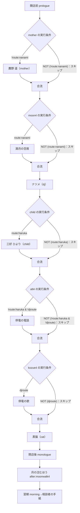
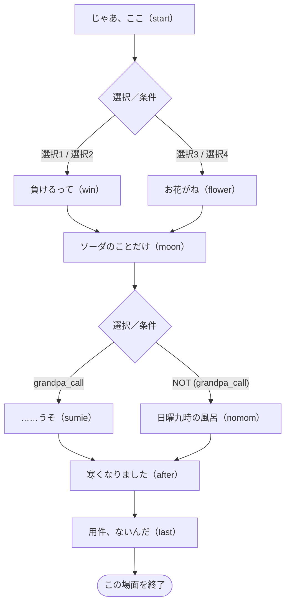
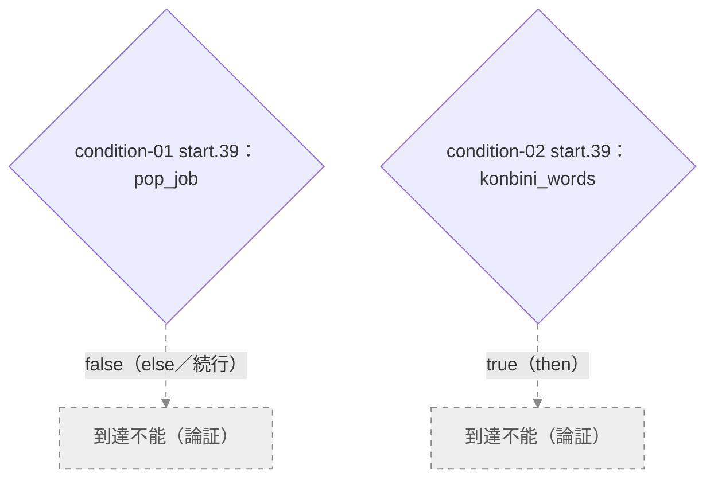
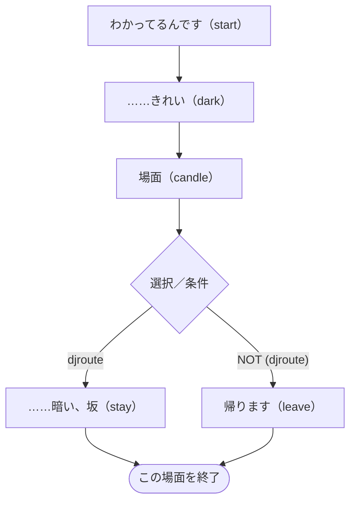
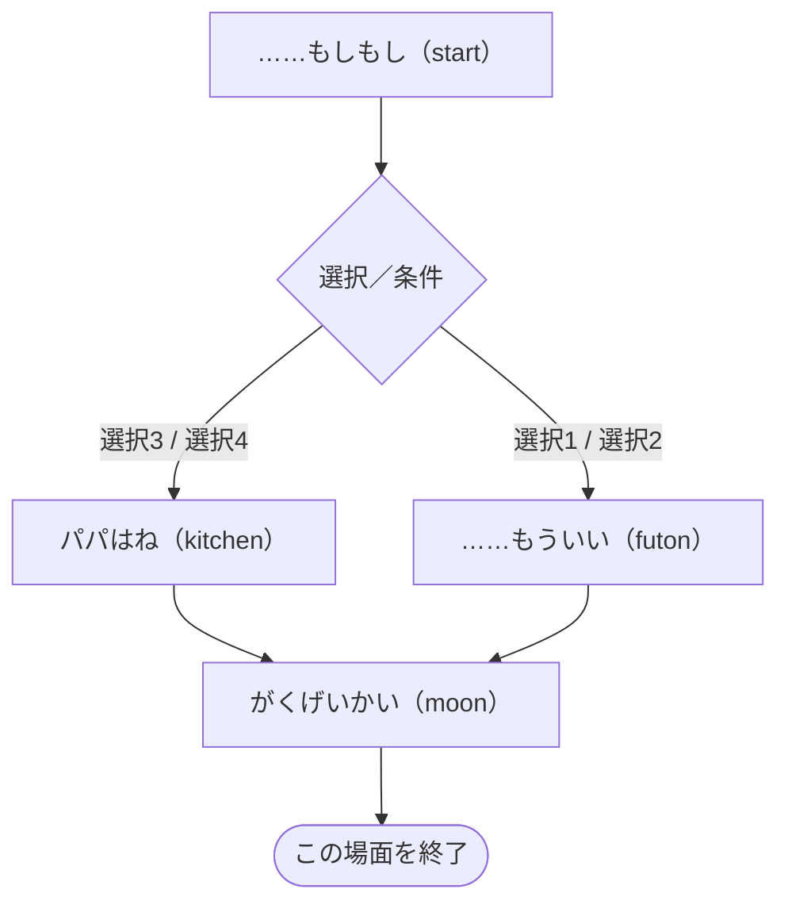
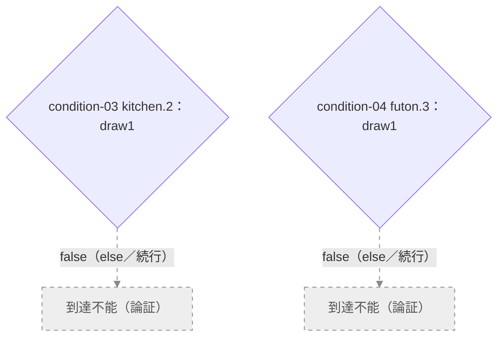

# 第四夜 — 満月と、三本のろうそく

> 自動生成：`node tools/generate-branchmaps.js`。実装の動作を記述。ネタバレを含みます。

[[../00_全体マップ|全体へ]] · [[../10_ルートとED|判定の詳細]]

## 到達性の凡例

グレーの破線ノード・矢印＝**到達不能（論証）**。**到達可能（再現確認）**＝初期状態から実エンジンで再生済み。状態リンクから検証資料の該当見出しへ移動できます。判定は記載したソース位置とtrue／false側だけに適用します。通常色の図や「個別判定なし」は到達可能の保証ではありません。通常の破線は状態依存にも使います。

## この夜の進行

根拠：[story/frame4.js](../../../story/frame4.js) · `nights.4` の `order / after / prologue / monologue / morning`。

**第四夜の差し替え**：七海ルートでは遥が来ず、ひよりは遥ルートだけ。`alt4` と `kozue4` は順に条件評価されます。条件不成立は図の合流先へ進みます。

## 場面ごとの分岐

ノードは短い場面の言葉とコード内のラベル名です。図の選択番号は該当choice/acts内の1始まり、表の先頭番号はscript全体でのカード群の通し番号（acts含む）です。ソース内位置で照合できます。同じ移動先は合流させています。表示条件の「制限なし」は、そのラベル・外側の条件を通ってカード群が実行されている場合を指します。状態を変える選択は表を優先して確認してください。全条件の正確な配列位置は [[../details/条件索引|条件索引]] と `data/branch-model.json` にあります。

### 後の展開への影響

`mother_letter / n4_bridge` は第五夜の澄江の結果と合わせて和解の判定へ。`child_tell` は次の夜の未来の三好の相談に差分を作ります。ナツメの選択は最終djを積み上げますが、入口djAt2を変えません。 根拠と参照先は [[../20_フラグ依存関係|フラグ依存関係]]・[[../details/条件索引|全参照索引]] にあります。

### 鷹野 遥（mother）

[story/mother.js](../../../story/mother.js) · `visitors.mother.script`。実行条件：`!route:nanami`。

#### 条件側の到達性

移動先が同じ会話差分も、条件の片側として表示しています。図の番号は下表に対応します。

| 番号・参照位置 | 条件側 | 状態・検証行 |
| --- | --- | --- |
| `condition-01` [story/mother.js](../../../story/mother.js) · `visitors.mother.script.start.39.then.6.else.0` | `pop_job = false` | [到達不能（論証）](../30_検証と要確認.md#condition-01) |
| `condition-02` [story/mother.js](../../../story/mother.js) · `visitors.mother.script.start.39.else.0.else.0` | `konbini_words = true` | [到達不能（論証）](../30_検証と要確認.md#condition-02) |

| 選択群-カード・短い文言 | 表示条件 | 状態変化 | 移動 | ソース内位置 |
| --- | --- | --- | --- | --- |
| 3-1 本当は、お母さんのことが好きなんですね | 制限なし | 距離:near | `win` | `start.60.choice.0` |
| 3-2 勝ち負けで考えなくても、いいのかもしれませんよ | 制限なし | 距離:far | `win` | `start.60.choice.1` |
| 3-3 中に何が入っているかは、もう、わかっているんですね | 制限なし | 距離:just | `flower` | `start.60.choice.2` |
| 3-4 （空になりかけた湯呑みに、黙ってほうじ茶を注ぎ足す） | 制限なし | 距離:odd | `flower` | `start.60.choice.3` |
| 4-1 （ウインナーコーヒーと湯呑みを、二つの空席のまん中へ… | 制限なし | n4_bridge ON / 距離:odd | 反応後に続行／合流 | `sumie.48.choice.0` |
| 4-2 お母さまは、小包が届いているか、ずっと気にしてらした… | 制限なし | n4_bridge ON / 距離:just | 反応後に続行／合流 | `sumie.48.choice.1` |
| 4-3 遥さんの描くPOP、わたしは好きですよ。熊のくしゃみも | 制限なし | 距離:near m-2 | 反応後に続行／合流 | `sumie.48.choice.2` |
| 4-4 お二人とも、今夜はこのくらいにしておきませんか | 制限なし | 距離:far | 反応後に続行／合流 | `sumie.48.choice.3` |
| 7-1 今夜帰ったら、七つ全部開けてみましょう。きっと楽にな… | 制限なし | 距離:near | `last` | `after.7.choice.0` |
| 7-2 開けるも開けないも、遥さんが決めていいことですから | 制限なし | 距離:far | `last` | `after.7.choice.1` |
| 7-3 七つぶんの返事を、一度にしなくてもいいんじゃないでし… | 制限なし | 距離:just | `last` | `after.7.choice.2` |
| 7-4 寒くなったね、で、いいんじゃないですか | 制限なし | 距離:odd m-2 good:false | `last` | `after.7.choice.3` |
| 8-1 お母さまも、きっと返事を待っていますよ | 制限なし | 距離:near | 反応後に続行／合流 | `last.7.choice.0` |
| 8-2 急がなくても大丈夫ですよ。今夜はもう遅いですし | 制限なし | 距離:far | 反応後に続行／合流 | `last.7.choice.1` |
| 8-3 用件がないから、書けることもあるのかもしれませんね | 制限なし | mother_letter ON / 距離:just | 反応後に続行／合流 | `last.7.choice.2` |
| 8-4 朝五時の鋏の音にも、用件はなかったのかもしれません | `memo:mother_hasami` | mother_letter ON / 距離:just | 反応後に続行／合流 | `last.7.choice.3` |
| 8-5 （何も言わずに、彼女が言葉を見つけるのを待つ） | 制限なし | mother_letter ON / 距離:odd | 反応後に続行／合流 | `last.7.choice.4` |

簡略化：acts 2群（採点なし）、直接の状態・移動指定がない通常カード 2群（相談者なら距離・結果には影響）。共通の採点式は [[../10_ルートとED#相談結果 good / mid / bad|相談結果]]。

参照する状態・条件：`route:haruka`、`konbini_words`、`kiri_job`、`pop_job`、`route:nanami | djroute`、`grandpa_call`、`n4_bridge`、`djroute`。会話差分も含み、すべてが移動分岐になるわけではありません。

### 満月の空席

[story/frame4.js](../../../story/frame4.js) · `nights.4.scenes.moon4.script`。実行条件：`route:nanami`。

`start` → 場面終了。途中のカードは反応後に同じ流れへ合流します。

参照する状態・条件：`grandpa_call`。会話差分も含み、すべてが移動分岐になるわけではありません。

### ナツメ（dj）

[story/frame4.js](../../../story/frame4.js) · `nights.4.dj.script`。

| 選択群-カード・短い文言 | 表示条件 | 状態変化 | 移動 | ソース内位置 |
| --- | --- | --- | --- | --- |
| 1-1 月を見ながら、ラジオをつけてる人も、きっといますよ | 制限なし | dj +2 | 反応後に続行／合流 | `start.9.choice.0` |
| 1-2 じゃあ、わたしが毎晩メールしますよ | 制限なし | dj +0 | 反応後に続行／合流 | `start.9.choice.1` |
| 1-3 満月なら、仕方ないですね。来月はまた増えますよ | 制限なし | dj -1 | 反応後に続行／合流 | `start.9.choice.2` |
| 1-4 （窓のブラインドを上まで上げて、月をカウンターに入れ… | 制限なし | dj +1 | 反応後に続行／合流 | `start.9.choice.3` |
| 2-1 半分くらいが、ちょうどいいのかもしれませんね | 制限なし | dj +2 | `candle` | `dark.33.choice.0` |
| 2-2 （自分の前のろうそくを、少しだけ遠ざける） | 制限なし | dj +2 | `candle` | `dark.33.choice.1` |
| 2-3 何でも話してください。何でも聞きますから | 制限なし | dj +0 | `candle` | `dark.33.choice.2` |
| 2-4 電気が戻ったら、明るいところで聞きますよ | 制限なし | dj -1 | `candle` | `dark.33.choice.3` |
| 3-1 その一言を、毎晩、誰かに返してるんですね | 制限なし | dj +2 | 反応後に続行／合流 | `candle.25.choice.0` |
| 3-2 （自分のマグを、ナツメのカップの隣に並べて置く） | 制限なし | dj +2 | 反応後に続行／合流 | `candle.25.choice.1` |
| 3-3 その人、どこかで今も聴いてるかもしれませんよ。探して… | 制限なし | dj +0 | 反応後に続行／合流 | `candle.25.choice.2` |
| 3-4 その人のほうは、たぶん、もう覚えてないでしょうね | 制限なし | dj -1 | 反応後に続行／合流 | `candle.25.choice.3` |

参照する状態・条件：`djroute`、`route:nanami`、`dj_umbrella`、`dj_mug`、`dj>=12`、`dj>=10`。会話差分も含み、すべてが移動分岐になるわけではありません。

### 三好 ひより（child）

[story/child.js](../../../story/child.js) · `visitors.child.script`。実行条件：`route:haruka`。

#### 条件側の到達性

移動先が同じ会話差分も、条件の片側として表示しています。図の番号は下表に対応します。

| 番号・参照位置 | 条件側 | 状態・検証行 |
| --- | --- | --- |
| `condition-03` [story/child.js](../../../story/child.js) · `visitors.child.script.kitchen.2.else.0` | `draw1 = false` | [到達不能（論証）](../30_検証と要確認.md#condition-03) |
| `condition-04` [story/child.js](../../../story/child.js) · `visitors.child.script.futon.3.else.0` | `draw1 = false` | [到達不能（論証）](../30_検証と要確認.md#condition-04) |

| 選択群-カード・短い文言 | 表示条件 | 状態変化 | 移動 | ソース内位置 |
| --- | --- | --- | --- | --- |
| 4-1 ひよりちゃんのせいなんかじゃない。ぜったい、ぜったい… | 制限なし | 距離:near | `futon` | `start.78.choice.0` |
| 4-2 パパとママのことは、パパとママにしかわからないからね | 制限なし | 距離:far | `futon` | `start.78.choice.1` |
| 4-3 パパもママも、あの夜がまだこわいのかもしれないね。ひ… | 制限なし | 距離:just | `kitchen` | `start.78.choice.2` |
| 4-4 ……もっちゃんは、なんて言ってる？ | 制限なし | 距離:odd | `kitchen` | `start.78.choice.3` |
| 6-1 こわい夜は、パパかママを起こしていいんだよ。朝になっ… | 制限なし | child_tell ON / 距離:just | 反応後に続行／合流 | `moon.16.choice.0` |
| 6-2 廊下の小さい電気、ずっとついてるんだよね。その下を通… | `memo:child_light` | child_tell ON / 距離:just | 反応後に続行／合流 | `moon.16.choice.1` |
| 6-3 じゃあ、いまからパパを起こして、ぜんぶ話そう。学芸会… | 制限なし | 距離:near m-2 | 反応後に続行／合流 | `moon.16.choice.2` |
| 6-4 もう遅いから、そろそろ寝ないとね。電話は、おしまいに… | 制限なし | 距離:far | 反応後に続行／合流 | `moon.16.choice.3` |
| 6-5 お月さまのセリフ、もう一回だけ、ここで聞かせてくれる？ | 制限なし | child_tell ON / 距離:odd | 反応後に続行／合流 | `moon.16.choice.4` |

簡略化：acts 2群（採点なし）、直接の状態・移動指定がない通常カード 2群（相談者なら距離・結果には影響）。共通の採点式は [[../10_ルートとED#相談結果 good / mid / bad|相談結果]]。

参照する状態・条件：`draw2`、`draw1`、`child_tell`。会話差分も含み、すべてが移動分岐になるわけではありません。

### 停電の電話

[story/frame4.js](../../../story/frame4.js) · `nights.4.scenes.alt4.script`。実行条件：`!route:haruka & !djroute`。

`start` → 場面終了。途中のカードは反応後に同じ流れへ合流します。

参照する状態・条件：`route:nanami`、`grandpa_call`、`n4_bridge`、`mother_letter`。会話差分も含み、すべてが移動分岐になるわけではありません。

### 停電の歌

[story/frame4.js](../../../story/frame4.js) · `nights.4.scenes.kozue4.script`。実行条件：`djroute`。

`start` → 場面終了。途中のカードは反応後に同じ流れへ合流します。

簡略化：acts 0群（採点なし）、直接の状態・移動指定がない通常カード 1群（相談者なら距離・結果には影響）。共通の採点式は [[../10_ルートとED#相談結果 good / mid / bad|相談結果]]。

参照する状態・条件：`kozue_tea`、`musician_song`、`dj_mug`、`hi_song`。会話差分も含み、すべてが移動分岐になるわけではありません。

### 黒猫（cat）

[story/frame4.js](../../../story/frame4.js) · `nights.4.cat.script`。

`start` → 場面終了。途中のカードは反応後に同じ流れへ合流します。

| 選択群-カード・短い文言 | 表示条件 | 状態変化 | 移動 | ソース内位置 |
| --- | --- | --- | --- | --- |
| 1-1 点けた火は、最後まで見届けたいのかもしれない | 制限なし | cat +1 | 反応後に続行／合流 | `start.30.choice.0` |
| 1-2 きみが来るかもしれないと思って、点けておいたんだよ | 制限なし | cat +0 | 反応後に続行／合流 | `start.30.choice.1` |
| 1-3 消し忘れてただけだよ。深い意味はない | 制限なし | cat -1 | 反応後に続行／合流 | `start.30.choice.2` |
| 1-4 （黙って、自分の前のろうそくを、猫の近くの床に下ろす） | 制限なし | cat +1 | 反応後に続行／合流 | `start.30.choice.3` |

参照する状態・条件：`djroute`。会話差分も含み、すべてが移動分岐になるわけではありません。

### 月の沈むほう

[story/frame4.js](../../../story/frame4.js) · `nights.4.scenes.moonwalk4.script`。

`start` → 場面終了。途中のカードは反応後に同じ流れへ合流します。

| 選択群-カード・短い文言 | 表示条件 | 状態変化 | 移動 | ソース内位置 |
| --- | --- | --- | --- | --- |
| 2-1 （角まで、並んで歩く） | 制限なし | dj_walk4 ON | 反応後に続行／合流 | `start.39.choice.0` |
| 2-2 おやすみなさい……は、まだでしたね | 制限なし | 採点なし・直接の状態変更なし | 反応後に続行／合流 | `start.39.choice.1` |
| 2-3 （缶を持った手を、少しだけ上げる） | 制限なし | 採点なし・直接の状態変更なし | 反応後に続行／合流 | `start.39.choice.2` |

簡略化：acts 0群（採点なし）、直接の状態・移動指定がない通常カード 1群（相談者なら距離・結果には影響）。共通の採点式は [[../10_ルートとED#相談結果 good / mid / bad|相談結果]]。

参照する状態・条件：`djroute`。会話差分も含み、すべてが移動分岐になるわけではありません。

## 開店前・独白・翌朝の状態参照

| 場面 | 条件 | ソース内位置 |
| --- | --- | --- |
| prologue | `route:haruka` | `STORY.nights.4.prologue.4` |
| prologue | `route:nanami` | `STORY.nights.4.prologue.5` |
| prologue | `djroute` | `STORY.nights.4.prologue.6` |
| prologue | `route:alone & !djroute` | `STORY.nights.4.prologue.7` |
| prologue | `djroute` | `STORY.nights.4.prologue.17` |
| monologue | `route:nanami` | `STORY.nights.4.monologue.4` |
| monologue | `grandpa_call` | `STORY.nights.4.monologue.4.then.1` |
| monologue | `route:haruka` | `STORY.nights.4.monologue.4.else.1` |
| monologue | `mother_letter` | `STORY.nights.4.monologue.4.else.2` |
| monologue | `route:haruka` | `STORY.nights.4.monologue.7` |
| monologue | `djroute` | `STORY.nights.4.monologue.8` |
| monologue | `!route:haruka & !djroute` | `STORY.nights.4.monologue.9` |
| morning | `djroute` | `STORY.nights.4.morning.3` |
| morning | `route:haruka` | `STORY.nights.4.morning.5` |
| morning | `route:nanami` | `STORY.nights.4.morning.5.else.0` |

